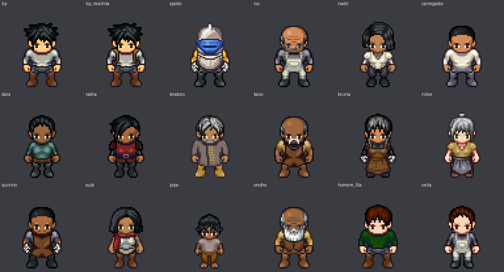

# Catálogo de personagens — Droids Code (Ato 1)

Fonte: TCC_-_ENREDO_v2.md e Adendo. Gerador: Universal LPC (repositório local, commit 9bf06be).

## A. Lista de personagens

**Protagonista**
- Felipe "Lip" Andrade — Protagonista; o garoto que conserta coisas
- Lip (variante com mochila) — Lip a partir da Sessão 6

**Companheiro**
- Apollo (placeholder LPC) — Mentor/companheiro; mediador pedagógico

**Antagonistas**
- Ivo Rangel — Técnico da Estação 7; trai por desespero e depois confessa
- Nadir Quintela — Intermediária da Apex
- Carregador da Apex (figurante) — Um dos dois carregadores que acompanham Nadir

**Facções e cidade**
- Rasha — Recrutadora da Flor de Ferro
- Teodoro Sampaio — Líder da Lótus Branca
- Dara — Moradora; balde vazio e depois cheio
- Senhor Tácio — Vendedor de água; segredo do cobre
- Mestra Bruna — Mestra da Guilda dos Sucateiros
- Nilce — Estalajadeira do Cano Torto
- Quirino — Ferreiro; instala a perna do Apollo
- Sula — Vendedora de peças; delata o droid
- Pipo — Criança que vê Nadir chegar
- Seu Onofre — Velho do viaduto; lembra do mundo antes
- Homem da Fila (figurante) — Homem da fila que diz "foi o Ivo"

**Referência**
- Célia Ferraz Rangel (referência de foto) — Autora do remendo 3.5; só aparece em foto

**Não montados**
- Artemis: Sem corpo por decisão do Adendo (C.1)
- Inês Andrade (mãe de Lip): Sem descrição visual; só voz e caligrafia
- Emílio "Milo" (irmão de Dara): Só mencionado; sem descrição
- Filha do Tácio, vizinha de Dara, pai do Pipo: Só mencionados
- Droid do Ivo, Sucatas de Captura, Droids selvagens, Drone de reconhecimento, Unidade de Manutenção Bastião 4, Droid de escolta: Não humanoides ou robóticos: o gerador LPC não cobre

## B. Correspondência visual

Tabela completa em `sprite-mapping.md`; cada personagem tem seu `character-config.md`.

## C. Arquivos gerados

Por personagem: `sprite.png`, `spritesheet.png`, `animations/*.png`, `character.json`, `character-config.md`.

- `Assets/Characters/Protagonist/`
- `Assets/Characters/Protagonist/variants/com_mochila/`
- `Assets/Characters/Companion/Apollo/`
- `Assets/Characters/Antagonists/Ivo_Rangel/`
- `Assets/Characters/Antagonists/Nadir_Quintela/`
- `Assets/Characters/Antagonists/Carregador_Apex/`
- `Assets/Characters/NPCs/Dara/`
- `Assets/Characters/NPCs/Rasha/`
- `Assets/Characters/NPCs/Teodoro_Sampaio/`
- `Assets/Characters/NPCs/Tacio/`
- `Assets/Characters/NPCs/Mestra_Bruna/`
- `Assets/Characters/NPCs/Nilce/`
- `Assets/Characters/NPCs/Quirino/`
- `Assets/Characters/NPCs/Sula/`
- `Assets/Characters/NPCs/Pipo/`
- `Assets/Characters/NPCs/Seu_Onofre/`
- `Assets/Characters/NPCs/Homem_da_Fila/`
- `Assets/Characters/NPCs/Celia_Ferraz_Rangel/`
- `Documentation/`: `character-catalog.md`, `sprite-mapping.md`, `animation-coverage.md`, `CREDITS.md`, `cast-overview.png`

## D. Pendências

- Props e emblemas sem peça: balde, caderneta, martelo, chave inglesa, contador Geiger, flor da Flor de Ferro, broche da Lótus.
- Apollo é placeholder (sem alto-falante, perna assimétrica, braço de carga).
- Inimigos e droids não foram montados (fora do escopo do gerador).
- Pele, cabelo e roupa da maioria dos personagens são sugestões; revise-as.
- Links do gerador não foram testados.

## E. Próximas etapas

1. Revisar as sugestões de design.
2. Importar `spritesheet.png` (grade 64×64) no motor, sem filtro.
3. Decidir o uso de `combat_idle`/`idle` nos combates.
4. Produzir camadas custom (emblemas, props) e as sprites finais do Apollo e dos inimigos.
5. Revisar licenças antes de distribuir.
