# DroidsCode — roteiro para completar 100% da versão da banca

**Guia atualizado em 14/11/2026 para a versão da banca de 13/11/2026. Contém spoilers e soluções.**

**Navegação:** [controles](#como-usar-os-controles-e-entregar-missões) · [todos os menus](#todos-os-menus-e-submenus) · [início do passo a passo](#parte-1--sair-de-casa-e-liberar-o-portão) · [todos os mapas](#atlas-completo-dos-mapas).

Neste guia, 100% significa encerrar o Ato 1, entregar as **18 quests disponíveis no catálogo desta versão** e resolver os sete puzzles montados no percurso. Não exige escolher as três facções na mesma partida: elas são alternativas. O caminho principal abaixo usa **Seguir sem facção**, que foi percorrido pelo teste de partida nova; as opcionais também foram concluídas pelo tester. O guia organiza essas provas em instruções para jogar manualmente; não houve uma nova partida manual seguindo este documento inteiro.

## Como usar os controles e entregar missões

- **WASD/setas:** andar. **E:** interagir perto de personagem ou terminal.
- **E, Espaço ou Enter:** avançar diálogo. Use o mouse nas escolhas e nos painéis.
- **Esc → Terminal:** aprender técnicas, distribuir pontos e equipar itens. Os terminais dos puzzles ficam no cenário: aproxime-se e pressione E.
- Para uma quest: escolha a oferta, confirme o aceite, cumpra os objetivos e volte ao personagem. Selecione **Entregar: [título]** e confirme **Concluir entrega**. Objetivo completo não significa recompensa entregue.
- Termine cada conversa. Depois feche o diálogo e pressione E novamente para a próxima fala. Muitas etapas da história exigem várias interações separadas.
- Ao copiar os códigos, substitua o conteúdo do editor e execute uma vez. Os códigos de atributos gastam pontos; não os repita sem conferir os pontos disponíveis.

## Todos os menus e submenus

Use o mouse para selecionar botões e a rolagem nas listas. **Voltar/Fechar** encerra o painel correspondente; termine conversas antes de abrir outros painéis. A tabela descreve os controladores e as ligações salvas da versão; não representa uma nova aprovação visual de todas as telas.

| Tela/menu | Como abrir | O que fazer e como sair |
|---|---|---|
| Menu inicial — `MainMenu` | Ao iniciar o executável | **Novo Jogo** leva à CasaLip; **Configurações** abre o volume; **Sair** fecha o jogo. O rótulo salvo é Novo Jogo. Não há botão Continuar ligado nesta cena. |
| Configurações iniciais | Menu inicial → Configurações | Ajuste o slider de volume; **Voltar** retorna ao início. Não confundir com Opções do menu durante a exploração. |
| Menu do mundo | **Esc**, fora de diálogo/combate | Oito botões: **Carregar, Salvar, Terminal, Status, Bag, Droid, Opções, Voltar**. Voltar retoma a exploração. |
| Salvar/Carregar | Esc → botão correspondente | A resposta aparece no próprio menu. Salvar grava o progresso; Carregar substitui a sessão pelo arquivo disponível. Não há tela de múltiplos slots descrita por esta versão. |
| Opções durante o jogo | Esc → Opções | Mostra **“Opções ainda não foi implementado.”**; não abre configurações adicionais. |
| Terminal de programação do Droid | Esc → Terminal | Edite Lua, consulte pontos/ajuda e pressione **Executar**. **Limpar** limpa o código; **Fechar** retorna. Aprender golpes, subir atributos e equipar usam os comandos do roteiro. A saída e a ajuda têm rolagem. |
| Terminal de puzzle | **E** perto do gerador, bancada ou painel do cenário | Mesma interface do terminal, com objetivo/contexto daquele puzzle. Leia o enunciado; cole a solução correspondente, execute e feche. Abrir o terminal pelo Esc não substitui interagir com o objeto necessário à quest. |
| Status | Esc → Status; também **Status** na batalha | Consulte HP, energia, atributos, técnicas, experiência, pontos e dinheiro. **Voltar** fecha. Distribuir pontos é pelo terminal, não pela imagem dos atributos. |
| Bag — exploração | Esc → Bag | Selecione item, leia descrição/quantidade, navegue pelas páginas e confirme **Usar** quando permitido. Equipamentos orientam **NO TERMINAL**; instalar/remover é pelo código. **Voltar** retorna ao menu. |
| Droid — equipamentos e técnicas | Esc → Droid | Examine os quatro slots, estoque, atributos, técnicas e comandos mostrados na inspeção. As grades têm páginas e o detalhe tem rolagem. Instale/remova no terminal; **Voltar** fecha. |
| Loja — Comprar | Converse com Senhor Tácio e escolha a loja/compra | Na aba **Comprar**, selecione produto, confira preço/saldo e confirme a ação para **uma unidade**. Repita para comprar mais; leia o retorno no rodapé. **Voltar** fecha. |
| Loja — Vender | Loja → aba Vender | Selecione um item com estoque e confirme uma unidade. Itens protegidos recusam a venda e permanecem no inventário; leia o balão/aviso. **Voltar** fecha. |
| Conversa e escolhas | **E** perto do NPC/objeto | **E, Espaço ou Enter** avança; clique nas respostas. As escolhas incluem aceitar quests, facção, retirada de itens e continuar a história. Termine a conversa e interaja outra vez quando o roteiro pedir. |
| Entrega de quest | Conversa com o responsável após cumprir objetivos | Selecione **Entregar: [título]**, confira e confirme **Concluir entrega**. Só concluir objetivos não entrega a recompensa. Este é um fluxo do diálogo, não um menu separado no Esc. |
| Diário de missões — disponibilidade limitada | Sem acesso ligado encontrado nesta montagem | Existe `QuestUIManager`, com listas de ativas/concluídas, objetivos, recompensas e curiosidades, mas não há referência ao componente nas cenas/prefabs pesquisados nem botão conectado no `MenuMundoManager`. Use o checklist deste guia e as conversas; não procure um botão Missões inexistente no menu atual. |
| Comandos de batalha — `Battle` | Interaja com um encontro liberado | **Atacar, Item, Fugir, Status**. Aguarde seu turno e leia HP/energia e mensagens. Fugir depende do encontro; pode falhar e fica indisponível quando proibido. |
| Batalha — golpes | Atacar | Com várias ações, selecione o golpe na lista rolável. Com uma única ação, o ataque pode ser direto. **Voltar/Esc** cancela o submenu sem executar golpe. |
| Batalha — itens/Bag | Item | Selecione e confirme uma cura/item permitido. Itens proibidos informam a recusa sem consumo; uso válido participa do turno. **Voltar/Esc** cancela a seleção; consulte também as páginas da Bag. |
| Batalha — Status | Status | Inspecione Apollo e feche com **Voltar** para retornar ao combate. Não confundir consulta de status com melhoria de atributos. |
| Derrota — `GameOver` | HP de Apollo chega a zero | **Continuar** tenta restaurar o último save/checkpoint com HP recuperável; sem arquivo válido mostra aviso. **Sair** volta ao menu inicial, não fecha o executável. Essa tela não grava progresso. |
| Vitória/epílogo | Vencer e concluir conversas finais | Leia o resultado e retome a exploração; conclua as falas do boss e volte às entregas pendentes. O fim do Ato 1 não substitui as opcionais e não é uma nova cena de mapa. |

**Uso recomendado ao seguir o roteiro:** conversa → aceitar → explorar/puzzle/combate → voltar ao responsável → entregar → conferir o checklist. Antes do boss: Bag para curas, Status para HP/defesa e Terminal para as melhorias indicadas.

## Onde encontrar os personagens e casas

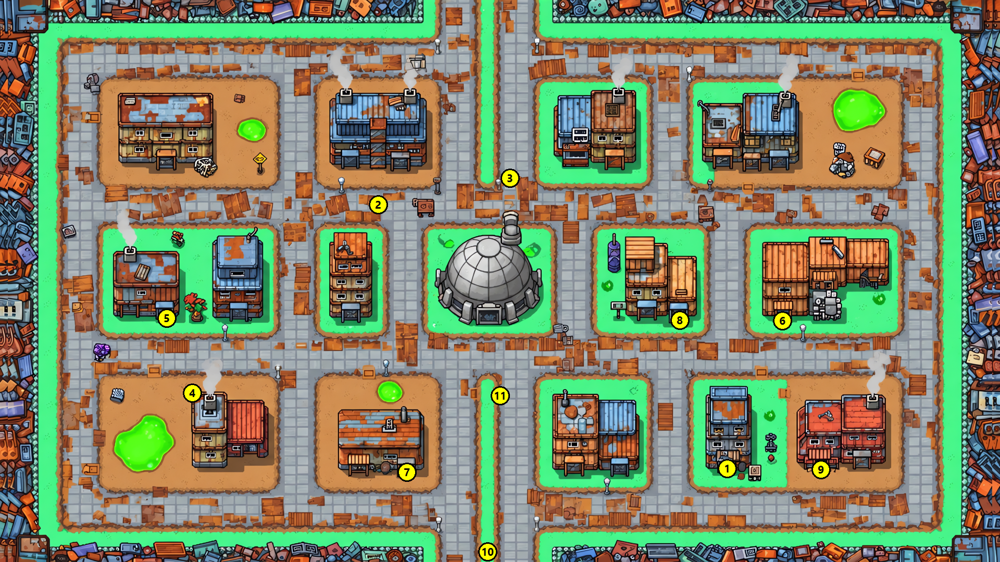

Os números abaixo são referências deste guia, desenhadas sobre o mapa. Não são placas novas dentro do jogo.

| Número | Local/pessoa | Para que serve |
|---|---|---|
| 1 | Entrada da casa inicial / CasaLip | Apollo e gerador de água |
| 2 | Dara, na praça | Água, filtro, terceira parte e cantil |
| 3 | Senhor Tácio, na praça | Loja e quests do cobre |
| 4 | Seu Onofre | Três marcas da Cratera |
| 5 | Casa/oficina de Quirino, E02 Principal | Bancada do filtro e reparo de Apollo; use a casa, não a garagem |
| 6 | Guilda / casa maior, E09 Térreo | Mestra Bruna, caçadas e triagem |
| 7 | Casa de Sula, E05 | Sula e Pipo; as duas portas levam à mesma casa |
| 8 | Estalagem, E08 Principal | Nilce e bomba de reserva; há duas entradas |
| 9 | Casa05, E11 | Terminal **RoloDeCobre** de Tácio |
| 10 | Saída para o vale/Cratera | Apollo do portão fica próximo; leva à exploração e aos combates |
| 11 | Nadir na cidade | Aparece no momento previsto pela história |

No vale/Cratera, procure os nomes de interação: **Apollo**, **Sucata de Captura**, **Rasha e Teodoro**, **Placa da rua**, **Degrau antigo**, **Canalização**, **Apollo — painel de energia**, **Unidade de manutenção**, **Ivo**, **Droid Selvagem** e **Selvagem Alfa**. Os nomes das cenas técnicas não são destinos para digitar em um terminal.

## Parte 1 — sair de casa e liberar o portão

1. No menu inicial, escolha **Novo Jogo** (inicia na CasaLip).
2. Converse com Apollo na casa até concluir a introdução.
3. Interaja com o terminal da casa. Resolva o gerador:

   ```lua
   nivel_agua = 0
   while nivel_agua < 100 do
     nivel_agua = nivel_agua + 10
   end
   ```

4. Feche o terminal, leia a confirmação e saia pela porta.
5. Na cidade, conclua as conversas com **Dara**, **Homem da fila** e **Senhor Tácio**.
6. Volte ao **Apollo — portão**, entregue **A cota cortada** e confirme a recompensa.
7. No terminal do menu, execute:

   ```lua
   droid.aprenderTecnica("Soco de Sobrecarga", 1)
   droid.subirAtributo("Dex", 3)
   ```

8. Fale novamente com Apollo para a conclusão da investigação. Interaja outra vez para o sino e outra para a recusa. Atravesse o portão quando liberado.

**Conferência:** a quest **A cota cortada** deve estar entregue; você deve conseguir sair para a Cratera e usar o golpe aprendido.

## Parte 2 — filtro, primeiro combate e facção

9. Antes de seguir longe, aceite **Um filtro para a Dara** com Dara.
10. Vá à oficina de Quirino, nº 5. Na **Bancada do filtro**, execute:

    ```lua
    residuo = 60
    pronto = 0
    while residuo >= 8 do
      residuo = residuo - 8
    end
    if residuo < 8 then
      pronto = 1
    end
    ```

11. Fale com Quirino e escolha **Levar o filtro para Dara**. Resolver a bancada não recolhe o filtro sozinho.
12. Volte a Dara, entregue o filtro e receba as curas.
13. No vale, converse com Apollo e enfrente a primeira **Sucata de Captura**, pressionando E no encontro. Em combate, use **Atacar** e escolha um golpe; use **Item/Bag** para se curar.
14. Após vencer, volte ao Apollo da chegada e conclua a conversa pós-combate.
15. Fale com **Rasha e Teodoro** e escolha **Seguir sem facção**.
16. Interaja novamente com eles para ouvir a explicação da Cratera e concluir a etapa do ponto vazio. Nessa rota não há módulo para recolher.

**Outras escolhas:** Flor de Ferro exige vencer a prova de Rasha, voltar, escolher **Continuar a luta** e depois **Receber o Núcleo de Sobrecarga**. Lótus Branca exige responder ao dilema de Teodoro e terminar a conversa do Módulo de Ressonância. São rotas alternativas; para ver todas as variações, faça partidas separadas.

## Parte 3 — recursos e preparo antes do boss

17. Na cidade, aceite **O que tinha antes da Cratera** com Seu Onofre.
18. Na Guilda, aceite **Limpeza da borda** com Mestra Bruna **antes** de fazer as três vitórias para a missão.
19. Na Cratera, examine com E, nesta ordem: **Placa da rua → Degrau antigo → Canalização**.
20. Vença três **Sucatas da borda**. Cure-se entre os combates.
21. Entregue a missão a Onofre e a caçada a Bruna. Se faltarem ouro ou pontos, aceite novamente **Limpeza da borda**, vença outras três Sucatas e entregue. Essa missão é repetível.
22. Quando tiver **pelo menos 11 pontos disponíveis**, execute uma vez:

    ```lua
    droid.melhorarTecnica("Soco de Sobrecarga", 2)
    droid.subirAtributo("For", 2)
    droid.subirAtributo("Dex", 2)
    droid.subirAtributo("Vit", 5)
    ```

23. Na loja de Tácio, compre **Placa de Blindagem**, **Óleo de Precisão** e curas. A placa custava 65 Gold na versão usada pelo roteiro. Equipe a placa no terminal:

    ```lua
    droid.equipar("placa_de_blindagem")
    ```

24. Continue ganhando pontos e suba VIT até **13**. Exemplo: se sua VIT atual é 8, são mais cinco pontos:

    ```lua
    droid.subirAtributo("Vit", 5)
    ```

    Ajuste a quantidade à sua VIT atual; não execute esse exemplo cegamente se já distribuiu pontos.

25. Antes do boss, confira a preparação conservadora usada pelo tester: **HP máximo de pelo menos 35, Defesa de pelo menos 19, vida e energia cheias, placa equipada e pelo menos 22 itens de cura somando poções pequenas/médias/grandes**. Reponha depois de curar fora de combate. Essa reserva é margem de segurança, não consumo obrigatório de toda luta. Ataques básicos nos encontros de preparo ajudam a recuperar energia.

**Guarde os materiais:** não venda Fios de Cobre, Sucata Limpa, Sensor Óptico ou a peça da perna de Apollo antes das entregas. As quests de coleta consomem seus materiais.

## Parte 4 — estação e vitória no boss

26. Fale com **Apollo — painel de energia** e leia o enunciado. No painel:

    ```lua
    energia = 0
    porta_aberta = 0
    while energia < 50 do
      energia = energia + 10
    end
    if energia >= 50 then
      porta_aberta = 1
    end
    ```

27. Examine a **Unidade de manutenção** e conclua a primeira fala.
28. Converse com Ivo três vezes, concluindo cada diálogo: reconhecimento/primeira mentira → Célia → proposta e escâner.
29. Confira as curas e pressione E no Ivo **mais uma vez** para iniciar o **Droid Improvisado**.
30. No combate:
    - Leia a **Próxima ação** anunciada antes de escolher seu turno.
    - Use Óleo de Precisão pela Bag no começo, se a vida permitir.
    - Use Soco de Sobrecarga enquanto disponível; ataque básico quando necessário.
    - Cure-se antes de entrar na faixa de risco. O tester cura com até 45% de HP e também antecipa a cura diante de ações perigosas e dano contínuo; não espere chegar a 1 HP.
    - O boss não permite fuga. Se perder, **Continuar** recupera o checkpoint anterior; reveja o preparo.

## Parte 5 — terminar realmente o Ato 1

31. Depois da vitória, conclua a fala do preço da memória. Se ela não abrir automaticamente, fale com Ivo.
32. Fale novamente com ele para a resolução da facção e depois para o caderno/religação da captação.
33. Volte à cidade e fale com **Apollo — portão** sobre a água. Entregue **A estação de captação**.
34. Guarde o servo/peça da perna recebido do chefe e tenha três Sucatas Limpas. Na oficina de Quirino, aceite e entregue **A perna do Apollo**.
35. **Interaja outra vez com Quirino para a fala do reparo.** Essa conversa é necessária para a continuação da história.
36. Volte ao Apollo do portão para a chegada de Nadir. Converse com Nadir em etapas: oferta → assembleia → fala de Dara → resposta da cidade/facção.
37. Volte ao Apollo para a conversa noturna e interaja novamente para preparar a mochila.
38. Vá a Dara e receba o cantil. Volte ao Apollo, leia a partida e escolha **Encerrar a demo**; termine a mensagem final.
39. Entregue **O nome na lista** ao Apollo. A vitória no boss sozinha não encerra o Ato 1.

## Parte 6 — completar as opcionais que faltam

Você pode fazer essas missões antes quando elas liberarem. A ordem abaixo segue o percurso de opcionais validado depois da história, para reduzir problemas de pré-requisitos. A cidade continua acessível no fluxo testado após o encerramento da demo; não comece uma Nova Partida para continuar a checklist.

40. **A peça que o Pipo viu:** casa de Sula, nº 7. Fale com Pipo, aceite a missão, converse novamente e entregue quando disponível. A oferta menciona uma bateria, mas o objetivo implementado nesta versão é conversar/ir com Pipo, não entregar uma bateria.
41. **O que a Sula vendeu:** na mesma casa, fale com Sula. Após a chegada de Nadir, aceite, conclua a conversa e entregue a missão.
42. **A terceira parte:** volte a Dara, aceite a continuação do filtro, reúna quatro Sucatas Limpas, pergunte sobre a terceira parte e entregue. Se também faltar Guilda I, reúna nove Sucatas no total para as duas entregas.
43. **Guilda I — Ferro velho e gente velha:** aceite com Bruna e entregue cinco Sucatas Limpas. Receba o emblema.
44. Como membro, resolva também **TriagemDaGuilda**, no térreo da Guilda. Esse puzzle é um extra de exploração, não uma das 18 quests:

    ```lua
    peca = 1
    reaproveitar = 0
    fundir = 0
    while peca <= 20 do
      if peca % 2 == 0 then
        reaproveitar = reaproveitar + 1
      else
        fundir = fundir + 1
      end
      peca = peca + 1
    end
    ```

45. **Guilda II — O que anda na Cratera:** aceite com Bruna **antes** de caçar. Vença cinco Droids Selvagens e junte três Fios de Cobre. Para evitar viagens, aceite também **Cobre é moeda** com Tácio e reúna **18 Fios de Cobre**: três para Guilda II, cinco para Tácio e dez para a continuação dele. O drop varia; cinco vitórias não garantem os 18 fios.
46. Volte a Bruna e entregue Guilda II.
47. **Guilda III — O Alfa:** aceite com Bruna, cure-se e enfrente o **Selvagem Alfa**. Leve o Sensor Óptico da vitória à Bruna e entregue. Guarde esse sensor para essa entrega.
48. **Guilda IV — O que a Guilda sabe:** aceite a continuação, ouça Bruna e entregue para receber a Chave de Acesso.
49. **Cobre é moeda:** entregue cinco Fios de Cobre a Tácio. Não reaceite a repetível se quer terminar sem quests ativas.
50. **Dezoito quilômetros:** aceite a continuação de Tácio, tenha mais dez fios e vá à casa nº 9. Resolva **RoloDeCobre depois de aceitar a missão**:

    ```lua
    total = 0
    quantas = 0
    while total <= 70 do
      total = total + 7
      quantas = quantas + 1
    end
    ```

    O resultado é total 77 e quantas 11. Volte a Tácio e entregue os fios e o objetivo do terminal. O diálogo fala em várias entregas, mas o pré-requisito implementado da continuação é a conclusão de Cobre é moeda.

51. **O quarto que não está quebrado:** estalagem, nº 8. Aceite com Nilce e use **BombaDeReserva**, no térreo:

    ```lua
    pressao = 0
    while pressao < 90 do
      pressao = pressao + 15
    end
    ```

    Volte a Nilce e entregue. A conversa do quarto três no andar superior é um extra narrativo; o objetivo dessa quest é a bomba.

52. **Toda terça:** volte ao Ivo após a história, aceite a manutenção e procure **Calibragem da bomba dois** na Cratera:

    ```lua
    forca_lida = droid.obterAtributo("For")
    previsao = forca_lida * 2
    ```

    Fale novamente com Ivo e entregue. Nesta demo, é uma manutenção única, não uma espera por terça-feira real.

## Checklist de 18/18 quests entregues

Marque apenas depois de receber a recompensa/confirmar a entrega no diálogo.

- [ ] A cota cortada
- [ ] A estação de captação
- [ ] O nome na lista
- [ ] Um filtro para a Dara
- [ ] A terceira parte
- [ ] Cobre é moeda
- [ ] Dezoito quilômetros
- [ ] A perna do Apollo
- [ ] Limpeza da borda
- [ ] A peça que o Pipo viu
- [ ] O que tinha antes da Cratera
- [ ] O quarto que não está quebrado
- [ ] Toda terça
- [ ] O que a Sula vendeu
- [ ] Guilda I — Ferro velho e gente velha
- [ ] Guilda II — O que anda na Cratera
- [ ] Guilda III — O Alfa
- [ ] Guilda IV — O que a Guilda sabe

**Fim de 100% desta versão:** Ato 1 encerrado, 18 entregues e nenhuma missão deixada ativa. Limpeza da borda e Cobre é moeda são repetíveis: completá-las uma vez conta; reaceitá-las no final deixa uma missão ativa de novo.

## Exploração extra e quando algo não avança

- Para visitar tudo, explore os 32 ambientes internos, suba e desça as escadas e use também as duas entradas da casa de Sula e da estalagem. Fale com moradores e examine os objetos de história. Não há uma conquista separada de 32/32 descrita por este guia.
- Os sete puzzles montados cobertos aqui são água, filtro, energia, triagem, rolo de cobre, bomba de reserva e calibragem. Tranca de três estágios, Janela da patrulha e Sintonia da antena também existem no catálogo de código, mas não entram como puzzles montados neste roteiro validado; não procure portas inexistentes para obtê-los.
- Se a missão não aparece, confira o pré-requisito da etapa anterior e termine o diálogo atual. Se o puzzle não libera, aceite a quest antes e converse com quem apresenta o terminal.
- Se um objetivo de derrota não aumenta, confira se a caçada foi aceita e se é o inimigo correto: Sucata da borda, Droid Selvagem e Selvagem Alfa têm objetivos diferentes.
- Se o item não foi recebido, procure a fala de retirada/entrega. O filtro, o reparo de Apollo, os módulos de facção e o caderno têm conversas próprias.
- Se o portão não libera: confira entrega da água, técnica aprendida, conclusão/sino/recusa de Apollo. Se o boss não começa: confira pós-combate, facção/módulo, enunciado do painel, energia, unidade e três falas de Ivo.

## Referência da versão

Este guia foi conferido contra os catálogos de quests/puzzles e os percursos de [partida nova](../../Assets/Editor/TesterPlayer.cs) e [opcionais](../../Assets/Editor/TesterPlayerOpcionais.cs). Evidências e limites dos testes estão no [plano da entrega](../planos-implementacao/2026-11-12-apresentacao-jogavel.md). Não usa alteração de flags nem concessão artificial de itens para completar as missões.

## Atlas completo dos mapas

Cobertura: **34 mapas de exploração = City + Game + CasaLip + 31 interiores**, além das três cenas de interface **MainMenu, Battle e GameOver** descritas na seção de menus. São as **37 cenas habilitadas no Build Settings** desta versão; não incluímos imagens da pasta NaoUsados como lugares visitáveis.

As imagens abaixo são os **fundos originais dos mapas**, não capturas de uma nova partida: não mostram NPCs, inimigos, portas sobrepostas nem todos os objetos em tempo de execução. Os círculos amarelos indicam o **centro dos gatilhos de passagem registrados no inventário**, com posição limitada à borda da imagem quando necessário; não representam contornos de colisão nem comprovam alinhamento visual de uma porta. A numeração deste atlas é independente dos 11 pontos de quests do mapa no início do guia.

Para explorar sem perder o percurso: comece na CasaLip, visite cada entrada da City, percorra escadas/apartamentos e volte pela passagem indicada. Depois siga para Game/Cratera e complete a história. Os IDs E00/E01/etc. identificam os prédios neste documento; não são placas garantidas dentro do jogo. Quests podem exigir retornar ao local após novos acontecimentos.

### Cidade — todas as entradas

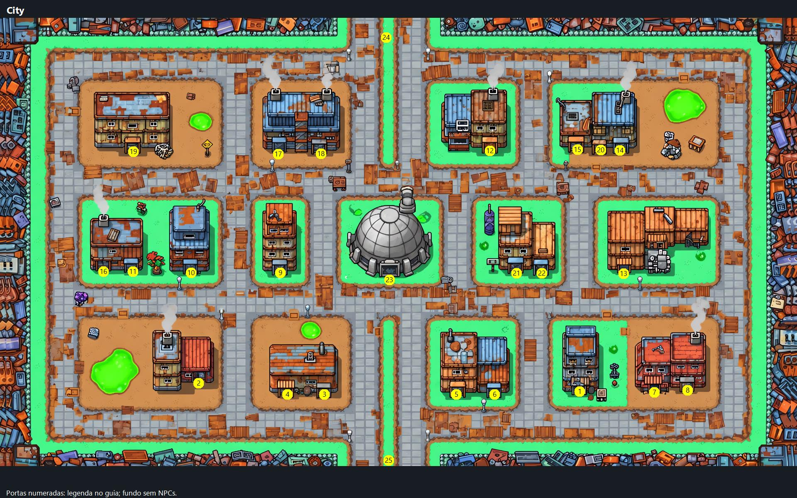

A passagem superior **24** está pendente, sem cena de destino; não é um mapa adicional. A saída **25**, para a Cratera, exige liberar o portão na Parte 1. Portas com nomes “Provisoria” são os nomes internos dos objetos existentes, não instruções para criar outras entradas.

| Ponto | Entrada na cidade | Destino |
|---|---|---|
| 1 | `Entrada_CasaLip` | [CasaLip](../../Assets/Scenes/CasaLip.unity) |
| 2 | `Porta_Casa01` | [Interior_E06_Terreo](../../Assets/Scenes/Interiores/Interior_E06_Terreo.unity) |
| 3 | `Porta_Casa02` | [Interior_E05_Principal](../../Assets/Scenes/Interiores/Interior_E05_Principal.unity) |
| 4 | `Porta_Casa02_Esquerda` | [Interior_E05_Principal](../../Assets/Scenes/Interiores/Interior_E05_Principal.unity) |
| 5 | `Porta_Casa03_Provisoria` | [Interior_E10_Casa03](../../Assets/Scenes/Interiores/Interior_E10_Casa03.unity) |
| 6 | `Porta_Casa04` | [Interior_E10_Casa04](../../Assets/Scenes/Interiores/Interior_E10_Casa04.unity) |
| 7 | `Porta_Casa05` | [Interior_E11_Casa05](../../Assets/Scenes/Interiores/Interior_E11_Casa05.unity) |
| 8 | `Porta_Casa06` | [Interior_E11_Casa06](../../Assets/Scenes/Interiores/Interior_E11_Casa06.unity) |
| 9 | `Porta_Casa07` | [Interior_E00_Hall](../../Assets/Scenes/Interiores/Interior_E00_Hall.unity) |
| 10 | `Porta_Casa08` | [Interior_E01_Hall](../../Assets/Scenes/Interiores/Interior_E01_Hall.unity) |
| 11 | `Porta_Casa09` | [Interior_E02_Principal](../../Assets/Scenes/Interiores/Interior_E02_Principal.unity) |
| 12 | `Porta_Casa10` | [Interior_E13_Hall](../../Assets/Scenes/Interiores/Interior_E13_Hall.unity) |
| 13 | `Porta_CasaMaior` | [Interior_E09_Terreo](../../Assets/Scenes/Interiores/Interior_E09_Terreo.unity) |
| 14 | `Porta_CasaPorao_Direita` | [Interior_E14_UnidadeB](../../Assets/Scenes/Interiores/Interior_E14_UnidadeB.unity) |
| 15 | `Porta_CasaPorao_Esquerda` | [Interior_E14_UnidadeA](../../Assets/Scenes/Interiores/Interior_E14_UnidadeA.unity) |
| 16 | `Porta_Garagem` | [Interior_E02_Garagem](../../Assets/Scenes/Interiores/Interior_E02_Garagem.unity) |
| 17 | `Porta_GeminadoAzul_A` | [Interior_E04_UnidadeA](../../Assets/Scenes/Interiores/Interior_E04_UnidadeA.unity) |
| 18 | `Porta_GeminadoAzul_B` | [Interior_E04_UnidadeB](../../Assets/Scenes/Interiores/Interior_E04_UnidadeB.unity) |
| 19 | `Porta_Mansao_Provisoria` | [Interior_E03_Terreo](../../Assets/Scenes/Interiores/Interior_E03_Terreo.unity) |
| 20 | `Porta_Porao` | [Interior_E14_Porao](../../Assets/Scenes/Interiores/Interior_E14_Porao.unity) |
| 21 | `Porta_PredioPlaca_A` | [Interior_E08_Principal](../../Assets/Scenes/Interiores/Interior_E08_Principal.unity) |
| 22 | `Porta_PredioPlaca_B` | [Interior_E08_Principal](../../Assets/Scenes/Interiores/Interior_E08_Principal.unity) |
| 23 | `Porta_Prefeitura` | [Interior_E16_Civico](../../Assets/Scenes/Interiores/Interior_E16_Civico.unity) |
| 24 | `SaidaSuperior_Pendente` | Pendente; sem destino |
| 25 | `SaidaCidade` | [Game](../../Assets/Scenes/Game.unity) |

### Vale / Cratera — Game

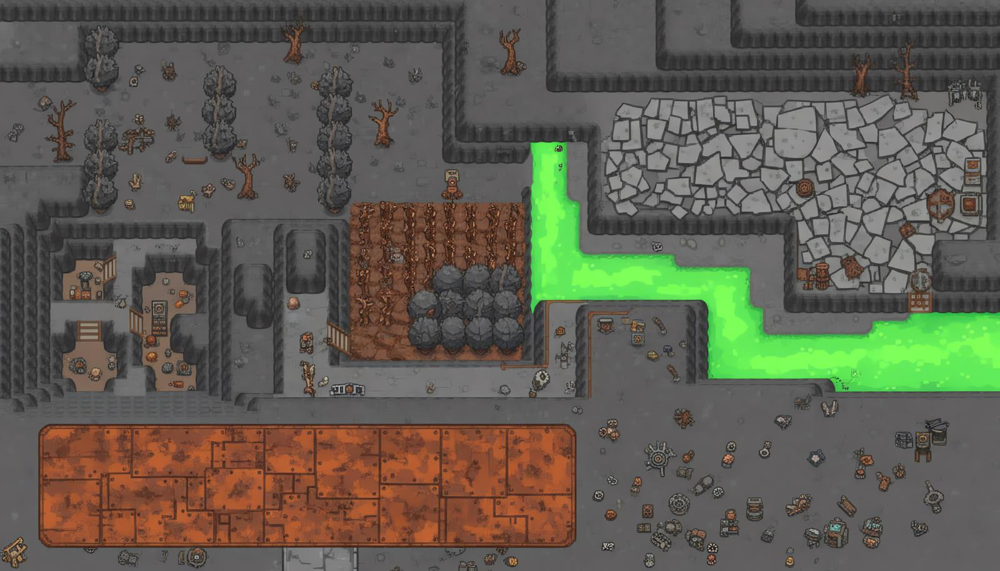

**Acesso:** City, passagem 25, após liberar o portão. **Retorno:** passagem de volta para City. Este é o mapa de exploração dos encontros, marcas antigas, painel de energia, unidade de manutenção, Ivo e boss; combates abrem a cena Battle e depois retornam à exploração. A ordem dos objetivos está nas Partes 2 a 5 do roteiro, não na ordem dos elementos desenhados no fundo.

**Cena:** [Game](../../Assets/Scenes/Game.unity) · [imagem original em tamanho integral](../../Assets/sprites/Mapas/ferrovale-original-upscale-4x.png).

### Todos os interiores, portas e escadas

Cada página mostra quatro mapas: leia de cima para baixo, esquerda para direita. A legenda de cada ambiente associa os números amarelos aos destinos. Clique em **fundo original** para ampliar um mapa individual. Os nomes de moradores são referências do inventário; presença e conversa podem depender da história.

#### Interiores — página 1

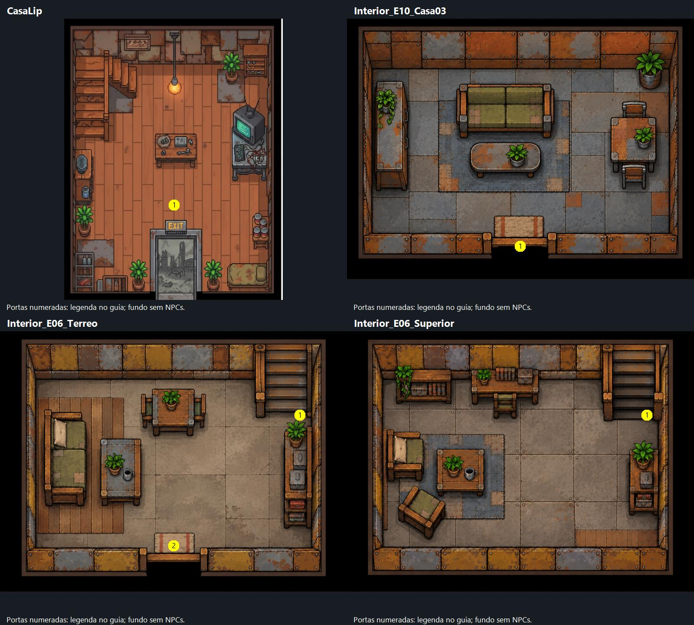

**[CasaLip](../../Assets/Scenes/CasaLip.unity)** · [fundo original](../../Assets/sprites/Mapas/LipCasa.jpg)

- **Entrar por:** Novo Jogo; City / passagem 1.
- **Passagens numeradas:** **1:** [City](../../Assets/Scenes/City.unity).
- **Referências de moradores:** Apollo.

**[Interior_E10_Casa03](../../Assets/Scenes/Interiores/Interior_E10_Casa03.unity)** · [fundo original](../../Assets/sprites/Mapas/Interiores/Casa03.png)

- **Entrar por:** City / passagem 5.
- **Passagens numeradas:** **1:** [City](../../Assets/Scenes/City.unity).
- **Referências de moradores:** Operario.

**[Interior_E06_Terreo](../../Assets/Scenes/Interiores/Interior_E06_Terreo.unity)** · [fundo original](../../Assets/sprites/Mapas/Interiores/e06-casa01-terreo.png)

- **Entrar por:** City / passagem 2; Interior_E06_Superior / passagem 1; Interior_E06_Anexo / passagem 1.
- **Passagens numeradas:** **1:** [Interior_E06_Superior](../../Assets/Scenes/Interiores/Interior_E06_Superior.unity); **2:** [City](../../Assets/Scenes/City.unity).
- **Referências de moradores:** Mecanico.

**[Interior_E06_Superior](../../Assets/Scenes/Interiores/Interior_E06_Superior.unity)** · [fundo original](../../Assets/sprites/Mapas/Interiores/e06-casa01-superior-v2.png)

- **Entrar por:** Interior_E06_Terreo / passagem 1.
- **Passagens numeradas:** **1:** [Interior_E06_Terreo](../../Assets/Scenes/Interiores/Interior_E06_Terreo.unity).


#### Interiores — página 2

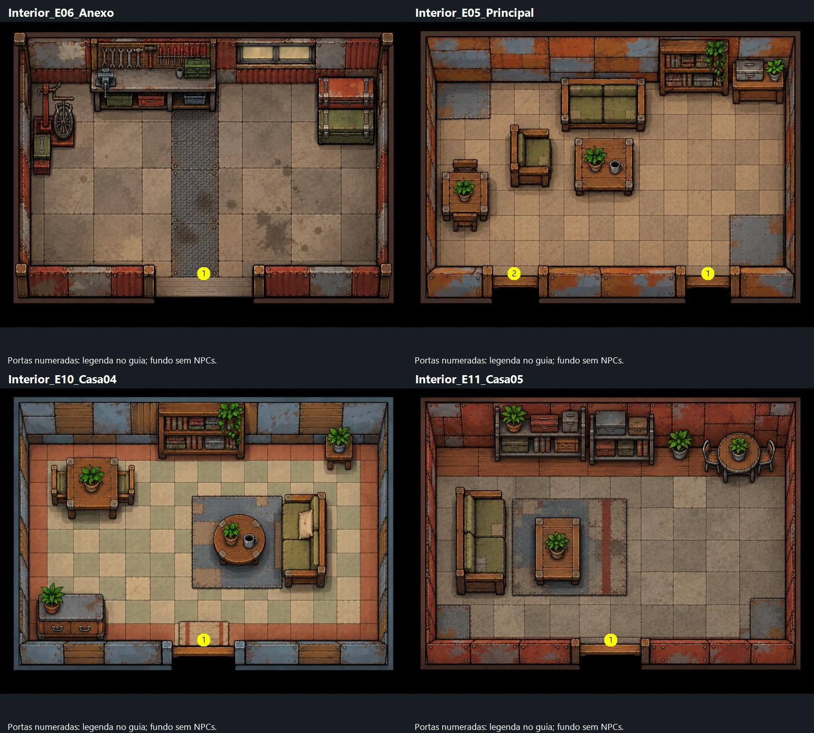

**[Interior_E06_Anexo](../../Assets/Scenes/Interiores/Interior_E06_Anexo.unity)** · [fundo original](../../Assets/sprites/Mapas/Interiores/e06-casa01-anexo.png)

- **Entrar por:** E06 Térreo / passagem para o anexo (referência serializada na cena; ausente na lista de portais do inventário).
- **Passagens numeradas:** **1:** [Interior_E06_Terreo](../../Assets/Scenes/Interiores/Interior_E06_Terreo.unity).
- **Referências de moradores:** Mecanico.

**[Interior_E05_Principal](../../Assets/Scenes/Interiores/Interior_E05_Principal.unity)** · [fundo original](../../Assets/sprites/Mapas/Interiores/e05-casa02.png)

- **Entrar por:** City / passagem 3; City / passagem 4.
- **Passagens numeradas:** **1:** [City](../../Assets/Scenes/City.unity); **2:** [City](../../Assets/Scenes/City.unity).
- **Referências de moradores:** Pipo, Crianca, Sula.

**[Interior_E10_Casa04](../../Assets/Scenes/Interiores/Interior_E10_Casa04.unity)** · [fundo original](../../Assets/sprites/Mapas/Interiores/e10-casa04.png)

- **Entrar por:** City / passagem 6.
- **Passagens numeradas:** **1:** [City](../../Assets/Scenes/City.unity).
- **Referências de moradores:** Homem da fila.

**[Interior_E11_Casa05](../../Assets/Scenes/Interiores/Interior_E11_Casa05.unity)** · [fundo original](../../Assets/sprites/Mapas/Interiores/e11-casa05.png)

- **Entrar por:** City / passagem 7.
- **Passagens numeradas:** **1:** [City](../../Assets/Scenes/City.unity).
- **Referências de moradores:** Senhor Tácio.


#### Interiores — página 3

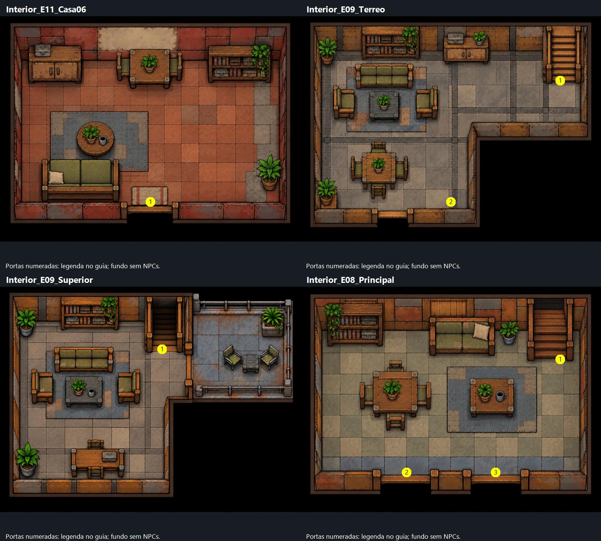

**[Interior_E11_Casa06](../../Assets/Scenes/Interiores/Interior_E11_Casa06.unity)** · [fundo original](../../Assets/sprites/Mapas/Interiores/e11-casa06.png)

- **Entrar por:** City / passagem 8.
- **Passagens numeradas:** **1:** [City](../../Assets/Scenes/City.unity).
- **Referências de moradores:** Idoso.

**[Interior_E09_Terreo](../../Assets/Scenes/Interiores/Interior_E09_Terreo.unity)** · [fundo original](../../Assets/sprites/Mapas/Interiores/e09-casa-maior-terreo.png)

- **Entrar por:** City / passagem 13; Interior_E09_Superior / passagem 1.
- **Passagens numeradas:** **1:** [Interior_E09_Superior](../../Assets/Scenes/Interiores/Interior_E09_Superior.unity); **2:** [City](../../Assets/Scenes/City.unity).
- **Referências de moradores:** Operario, Mestra Bruna.

**[Interior_E09_Superior](../../Assets/Scenes/Interiores/Interior_E09_Superior.unity)** · [fundo original](../../Assets/sprites/Mapas/Interiores/e09-superior-terraco-v2.png)

- **Entrar por:** Interior_E09_Terreo / passagem 1.
- **Passagens numeradas:** **1:** [Interior_E09_Terreo](../../Assets/Scenes/Interiores/Interior_E09_Terreo.unity).

**[Interior_E08_Principal](../../Assets/Scenes/Interiores/Interior_E08_Principal.unity)** · [fundo original](../../Assets/sprites/Mapas/Interiores/e08-casa-duas-entradas.png)

- **Entrar por:** City / passagem 21; City / passagem 22; Interior_E08_Superior / passagem 1.
- **Passagens numeradas:** **1:** [Interior_E08_Superior](../../Assets/Scenes/Interiores/Interior_E08_Superior.unity); **2:** [City](../../Assets/Scenes/City.unity); **3:** [City](../../Assets/Scenes/City.unity).
- **Referências de moradores:** Nilce.


#### Interiores — página 4

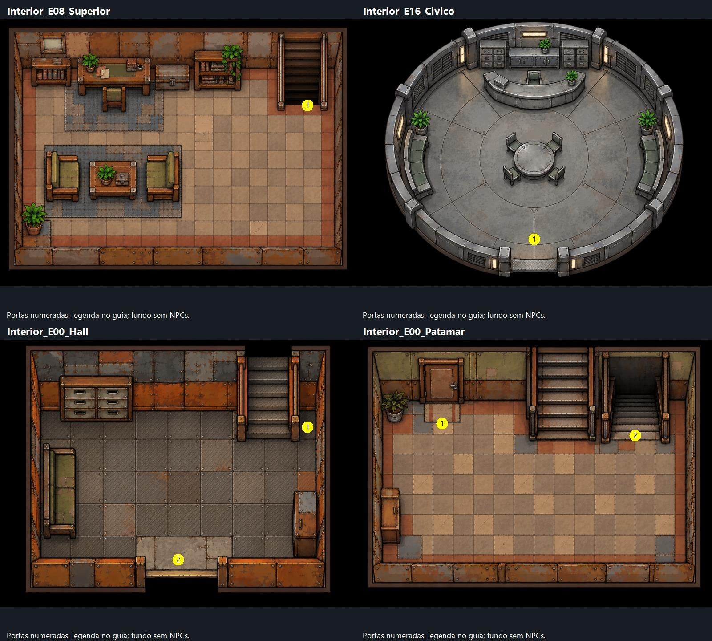

**[Interior_E08_Superior](../../Assets/Scenes/Interiores/Interior_E08_Superior.unity)** · [fundo original](../../Assets/sprites/Mapas/Interiores/matriz-casa-grande-superior-v1.png)

- **Entrar por:** Interior_E08_Principal / passagem 1.
- **Passagens numeradas:** **1:** [Interior_E08_Principal](../../Assets/Scenes/Interiores/Interior_E08_Principal.unity).
- **Referências de moradores:** Zeca.

**[Interior_E16_Civico](../../Assets/Scenes/Interiores/Interior_E16_Civico.unity)** · [fundo original](../../Assets/sprites/Mapas/Interiores/e16-prefeitura-domo.png)

- **Entrar por:** City / passagem 23.
- **Passagens numeradas:** **1:** [City](../../Assets/Scenes/City.unity).

**[Interior_E00_Hall](../../Assets/Scenes/Interiores/Interior_E00_Hall.unity)** · [fundo original](../../Assets/sprites/Mapas/Interiores/e00-casa07-hall.png)

- **Entrar por:** City / passagem 9; Interior_E00_Patamar / passagem 2.
- **Passagens numeradas:** **1:** [Interior_E00_Patamar](../../Assets/Scenes/Interiores/Interior_E00_Patamar.unity); **2:** [City](../../Assets/Scenes/City.unity).

**[Interior_E00_Patamar](../../Assets/Scenes/Interiores/Interior_E00_Patamar.unity)** · [fundo original](../../Assets/sprites/Mapas/Interiores/matriz-predio-corredor-v1.png)

- **Entrar por:** Interior_E00_Hall / passagem 1; Interior_E00_Apartamento01 / passagem 1.
- **Passagens numeradas:** **1:** [Interior_E00_Apartamento01](../../Assets/Scenes/Interiores/Interior_E00_Apartamento01.unity); **2:** [Interior_E00_Hall](../../Assets/Scenes/Interiores/Interior_E00_Hall.unity).


#### Interiores — página 5

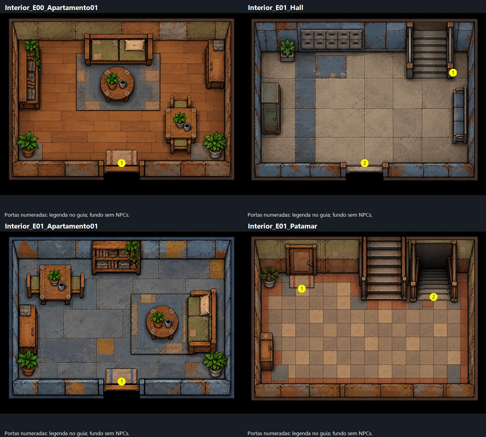

**[Interior_E00_Apartamento01](../../Assets/Scenes/Interiores/Interior_E00_Apartamento01.unity)** · [fundo original](../../Assets/sprites/Mapas/Interiores/apartamento-b-estar-norte-v2.png)

- **Entrar por:** Interior_E00_Patamar / passagem 1.
- **Passagens numeradas:** **1:** [Interior_E00_Patamar](../../Assets/Scenes/Interiores/Interior_E00_Patamar.unity).
- **Referências de moradores:** Vendedor.

**[Interior_E01_Hall](../../Assets/Scenes/Interiores/Interior_E01_Hall.unity)** · [fundo original](../../Assets/sprites/Mapas/Interiores/e01-casa08-hall.png)

- **Entrar por:** City / passagem 10; Interior_E01_Patamar / passagem 2.
- **Passagens numeradas:** **1:** [Interior_E01_Patamar](../../Assets/Scenes/Interiores/Interior_E01_Patamar.unity); **2:** [City](../../Assets/Scenes/City.unity).

**[Interior_E01_Apartamento01](../../Assets/Scenes/Interiores/Interior_E01_Apartamento01.unity)** · [fundo original](../../Assets/sprites/Mapas/Interiores/e01-apartamento-metal.png)

- **Entrar por:** Interior_E01_Patamar / passagem 1.
- **Passagens numeradas:** **1:** [Interior_E01_Patamar](../../Assets/Scenes/Interiores/Interior_E01_Patamar.unity).
- **Referências de moradores:** Hacker.

**[Interior_E01_Patamar](../../Assets/Scenes/Interiores/Interior_E01_Patamar.unity)** · [fundo original](../../Assets/sprites/Mapas/Interiores/matriz-predio-corredor-v1.png)

- **Entrar por:** Interior_E01_Hall / passagem 1; Interior_E01_Apartamento01 / passagem 1.
- **Passagens numeradas:** **1:** [Interior_E01_Apartamento01](../../Assets/Scenes/Interiores/Interior_E01_Apartamento01.unity); **2:** [Interior_E01_Hall](../../Assets/Scenes/Interiores/Interior_E01_Hall.unity).


#### Interiores — página 6

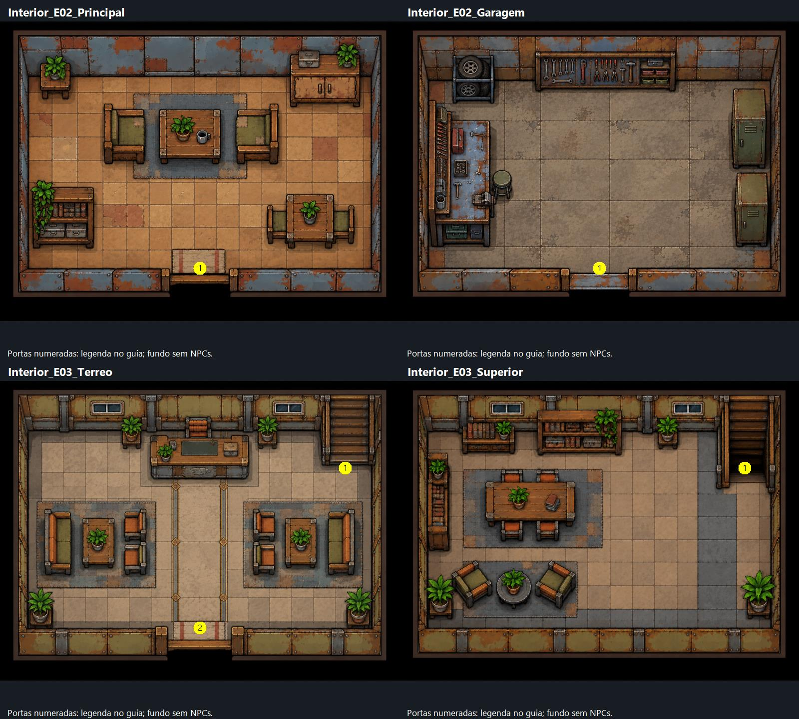

**[Interior_E02_Principal](../../Assets/Scenes/Interiores/Interior_E02_Principal.unity)** · [fundo original](../../Assets/sprites/Mapas/Interiores/e02-casa09.png)

- **Entrar por:** City / passagem 11.
- **Passagens numeradas:** **1:** [City](../../Assets/Scenes/City.unity).
- **Referências de moradores:** Quirino.

**[Interior_E02_Garagem](../../Assets/Scenes/Interiores/Interior_E02_Garagem.unity)** · [fundo original](../../Assets/sprites/Mapas/Interiores/e02-garagem.png)

- **Entrar por:** City / passagem 16.
- **Passagens numeradas:** **1:** [City](../../Assets/Scenes/City.unity).
- **Referências de moradores:** Quirino.

**[Interior_E03_Terreo](../../Assets/Scenes/Interiores/Interior_E03_Terreo.unity)** · [fundo original](../../Assets/sprites/Mapas/Interiores/e03-mansao-terreo.png)

- **Entrar por:** City / passagem 19; Interior_E03_Superior / passagem 1.
- **Passagens numeradas:** **1:** [Interior_E03_Superior](../../Assets/Scenes/Interiores/Interior_E03_Superior.unity); **2:** [City](../../Assets/Scenes/City.unity).

**[Interior_E03_Superior](../../Assets/Scenes/Interiores/Interior_E03_Superior.unity)** · [fundo original](../../Assets/sprites/Mapas/Interiores/e03-mansao-superior-v2.png)

- **Entrar por:** Interior_E03_Terreo / passagem 1.
- **Passagens numeradas:** **1:** [Interior_E03_Terreo](../../Assets/Scenes/Interiores/Interior_E03_Terreo.unity).


#### Interiores — página 7

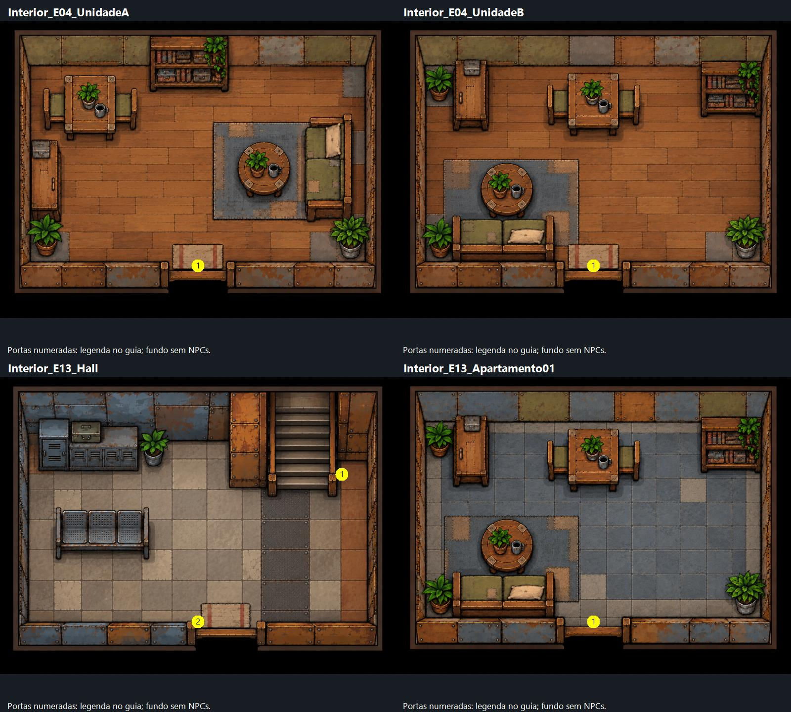

**[Interior_E04_UnidadeA](../../Assets/Scenes/Interiores/Interior_E04_UnidadeA.unity)** · [fundo original](../../Assets/sprites/Mapas/Interiores/apartamento-c-estar-leste-v2.png)

- **Entrar por:** City / passagem 17.
- **Passagens numeradas:** **1:** [City](../../Assets/Scenes/City.unity).
- **Referências de moradores:** Dara.

**[Interior_E04_UnidadeB](../../Assets/Scenes/Interiores/Interior_E04_UnidadeB.unity)** · [fundo original](../../Assets/sprites/Mapas/Interiores/apartamento-d-mesa-norte-v2.png)

- **Entrar por:** City / passagem 18.
- **Passagens numeradas:** **1:** [City](../../Assets/Scenes/City.unity).
- **Referências de moradores:** Vizinha dara.

**[Interior_E13_Hall](../../Assets/Scenes/Interiores/Interior_E13_Hall.unity)** · [fundo original](../../Assets/sprites/Mapas/Interiores/e13-casa10-hall.png)

- **Entrar por:** City / passagem 12; Interior_E13_Patamar / passagem 2.
- **Passagens numeradas:** **1:** [Interior_E13_Patamar](../../Assets/Scenes/Interiores/Interior_E13_Patamar.unity); **2:** [City](../../Assets/Scenes/City.unity).

**[Interior_E13_Apartamento01](../../Assets/Scenes/Interiores/Interior_E13_Apartamento01.unity)** · [fundo original](../../Assets/sprites/Mapas/Interiores/e13-apartamento-ceramica.png)

- **Entrar por:** Interior_E13_Patamar / passagem 1.
- **Passagens numeradas:** **1:** [Interior_E13_Patamar](../../Assets/Scenes/Interiores/Interior_E13_Patamar.unity).
- **Referências de moradores:** Cientista.


#### Interiores — página 8

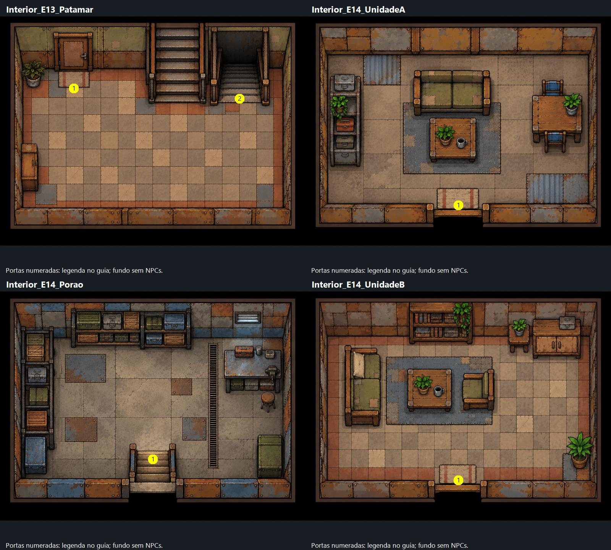

**[Interior_E13_Patamar](../../Assets/Scenes/Interiores/Interior_E13_Patamar.unity)** · [fundo original](../../Assets/sprites/Mapas/Interiores/matriz-predio-corredor-v1.png)

- **Entrar por:** Interior_E13_Hall / passagem 1; Interior_E13_Apartamento01 / passagem 1.
- **Passagens numeradas:** **1:** [Interior_E13_Apartamento01](../../Assets/Scenes/Interiores/Interior_E13_Apartamento01.unity); **2:** [Interior_E13_Hall](../../Assets/Scenes/Interiores/Interior_E13_Hall.unity).

**[Interior_E14_UnidadeA](../../Assets/Scenes/Interiores/Interior_E14_UnidadeA.unity)** · [fundo original](../../Assets/sprites/Mapas/Interiores/e14-unidade-esquerda.png)

- **Entrar por:** City / passagem 15.
- **Passagens numeradas:** **1:** [City](../../Assets/Scenes/City.unity).
- **Referências de moradores:** Benta.

**[Interior_E14_Porao](../../Assets/Scenes/Interiores/Interior_E14_Porao.unity)** · [fundo original](../../Assets/sprites/Mapas/Interiores/e14-porao.png)

- **Entrar por:** City / passagem 20.
- **Passagens numeradas:** **1:** [City](../../Assets/Scenes/City.unity).

**[Interior_E14_UnidadeB](../../Assets/Scenes/Interiores/Interior_E14_UnidadeB.unity)** · [fundo original](../../Assets/sprites/Mapas/Interiores/interior-sala-piso-cuidado-v3.png)

- **Entrar por:** City / passagem 14.
- **Passagens numeradas:** **1:** [City](../../Assets/Scenes/City.unity).
- **Referências de moradores:** Guarda.

### Limites de exploração desta versão

- Os patamares E00, E01 e E13 têm um apartamento montado por prédio; a escada superior reservada não libera outros andares nesta entrega. A ampliação para três ou quatro andares continua como melhoria futura.
- E06 Anexo aparece nas cenas habilitadas e tem retorno para E06 Térreo. A entrada consta como referência serializada no térreo, mas não está na lista de portais do inventário usado para os marcadores; por isso não inventamos uma posição amarela para ela.
- MainMenu, Battle e GameOver são as outras três cenas: telas de entrada, combate e derrota, sem interiores adicionais para visitar. Seus acessos e submenus estão documentados acima.

**Fontes do atlas:** [cenas habilitadas](../../ProjectSettings/EditorBuildSettings.asset), [inventário de circulação](../../output/apresentacao-jogavel/2026-11-12/circulacao/inventario-colisores-ativos/inventario.json) e imagens originais referenciadas. [Gerador das imagens](gerar-atlas-roteiro.ps1): somente leitura das fontes, sem operar o Unity.
