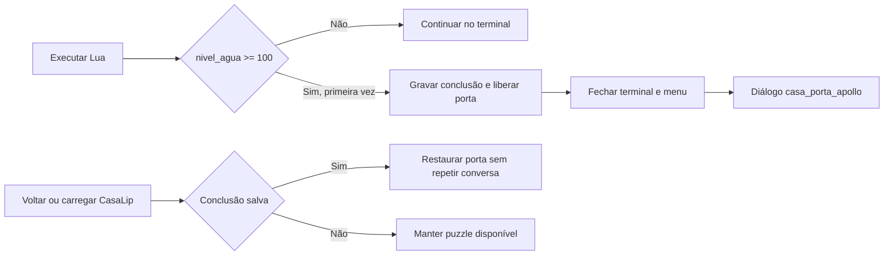

# Plano de implementação — Correções da CasaLip

> **Para execução:** seguir [AGENTS.md](../../AGENTS.md). A retomada abaixo prevalece sobre os checklists e registros anteriores. Não reexecutar etapas verificadas só porque uma caixa histórica ficou aberta.

**Nome do plano:** Correções da CasaLip — Diálogos, Sprites e Persistência.

**Data:** 16/10/2026, America/Sao_Paulo.

**Estado em 17/10/2026:** entrega parcial; porta/diálogo aprovados, escala dos menus rejeitada. Ver retomada vigente. Registro anterior: implementação aplicada; validação final parcial. Veja [resultados e pendências observados](../revisoes/casalip-validacao-2026-10-17.md). O processo ainda não atende a todos os critérios de encerramento.

**Base de referência:** `027952041d40e7957875a66641727684586455c1`, branch `docs/consolidar-contexto`, com alterações documentais e configuração local já existentes.

**O que este plano tenta corrigir:** a janela de diálogo da CasaLip ficou pequena e deformada após alterações em âncoras e escalas; Apollo ainda usa uma sprite e um retrato de mago, com o nome distante do personagem; Lip usa o corpo-base sem as novas roupas; a vitória do puzzle aparece como texto isolado em vez de conversa do catálogo; e, ao retornar de City, a porta nasce trancada e o terminal perde sua referência. A flag `ato1_casa_resolvida` também é gravada pela conversa introdutória, misturando conversar com resolver o puzzle.

**Objetivo:** deixar a CasaLip legível e visualmente coerente, com sucesso apresentado pelo diálogo de Apollo e conclusão preservada em revisitas e carregamento.

**Arquitetura:** manter a porta e o controlador do puzzle locais à cena, recuperando a conclusão do GerenciadorDeEstado. Reutilizar VerificadorDePuzzle e CatalogoDeDialogos, associando-os à UI persistente válida. O terminal e o menu devem controlar suas próprias aberturas/fechamentos sem duplicar bloqueios de movimento.

**Tecnologias:** Unity `6000.5.8f1`, C#, uGUI, TextMeshPro, MoonSharp e MCP do Unity.

**Especificação e evidências:** [análise das seis capturas](../problemas/casalip-apresentacao-dialogo.md), [revisão da casa](../revisoes/casalip.md), [relato da revisita](../problemas/casalip-retorno-porta-trancada.md), [guia de montagem](../guias/montagem-ato-1.md) e [validação](../guias/validacao-jogo.md). Este plano detalha `UI-003`, `VIS-001`, `UI-001/TER-002`, `INT-001/HIS-001` e a parte de `HIS-002` relativa ao sucesso da água no [plano principal](../plano-desenvolvimento.md).

## Retomada vigente

### Diagnóstico do Apollo real após nova rejeição — 17/10/2026

Usuário relata permanência em idle e solicita análise do objeto. Inspeção MCP somente de leitura: DroidsCode/CasaLip fora de Play, dirty=true (preservado), Apollo com Transform/SpriteRenderer/BoxCollider2D/NpcInterativo/dois GatilhoDeDialogo/OrientacaoNpc, sem Animator. OrientacaoNpc habilitado, renderer no mesmo GameObject e sprite atual idle_4; método TentarInteragir presente na versão carregada. Nenhum outro SpriteRenderer de ordem igual/superior apareceu sobreposto nos objetos consultados; LipCasa_0 intersecta os bounds, mas tem ordem 0, abaixo de Apollo (ordem 1). Nos scripts do projeto, OrientacaoNpc é o escritor da sprite do NPC; DialogoUIManager escreve o retrato, PlayerMovement altera flips do Player.

Jogador em `(-0.57, -0.03)`, Apollo em `(3.39, 0.31)`, ambos gatilhos com `_playerPerto=false`; GerenciadorDeEstado ausente fora de Play. O vetor atual escolheria idle_2, mas não houve execução de interação neste estado de edição. Isso não explica nem invalida a falha relatada em partida. Não há evidência de Animator prendendo idle; falta observar E/proximidade/menus/sprite na sessão real. O componente implementa poses estáticas (todas com nomes idle), não locomoção ou ciclo de caminhada.

Próximo passo solicitado ao usuário: entrar em Play, posicionar-se à esquerda de Apollo, apertar E, fechar a fala e manter a sessão nessa posição para captura do estado real. Aguardar esse preparo; não iniciar Play, simular conversa, mover jogador, editar valores, salvar a cena suja ou alterar saves por conta do agente. Nenhum script ou montagem alterado neste diagnóstico. Uma primeira consulta de diagnóstico não compilou por usar GetInstanceID obsoleto; corrigida apenas a consulta temporária, sem erro novo nos fontes do projeto. Causa da falha de integração ainda não comprovada.

### Fala repetível do Apollo após a introdução — 17/10/2026

**Resultado aplicado:** catálogo recompilado retornou uma fala com falante Apollo e texto “Por que não vamos lá fora?”. Segundo gatilho adicionado via MCP ao Apollo e cena salva (`SaveScene=true`, dirty=false naquele momento), exigindo a flag da introdução, sem efeito de conclusão e com repetição habilitada. NpcInterativo genérico desabilitado; introdução, orientação e transform preservados. Nenhuma fala foi executada pelo agente; repetição por E e apresentação ainda dependem do teste do usuário. A edição preexistente de posição Y de UI (`300.0006` → `218.70546`) e o componente de orientação montado pelo usuário foram preservados. Nenhum save/backup ou flag foi acessado/modificado nesta tarefa. Após importar/recompilar o catálogo, consulta final encontrou CasaLip fora de Play e dirty=true; não salvar novamente nem descartar alterações de origem não identificada. O gatilho já está persistido em disco. Diff tem espaços ao fim de três campos YAML vazios serializados pelo Unity; não são mudança funcional. Próximo passo: usuário testar E após a introdução, fechar a fala e repetir; não declarar orientação funcionando com base nesta configuração.

Pedido: permitir continuar testando interações sem resetar a cena. Escopo: `CatalogoDeDialogos.cs` (novo Id `casa_apollo_conversa`, fala de Apollo: “Por que não vamos lá fora?”), objeto Apollo em `CasaLip.unity` e este plano/subcontexto. Adicionar segundo GatilhoDeDialogo, AoInteragir/E, exigindo `ato1_falou_apollo_casa`, sem flags impeditivas, sem flagAoTerminar e com apenasUmaVez=false. A introdução mantém suas condições opostas e continua única. Desabilitar somente o NpcInterativo genérico do Apollo, que emite o log placeholder mostrado pelo usuário; ambos os diálogos serão atendidos pelos gatilhos existentes, sem dois despachos de NPC. Preservar orientação, sprites, posição/escala, colisores, Canvas, porta e demais NPCs.

Estado anterior confirmado: DroidsCode/CasaLip em Play, cena sem alterações pendentes, um gatilho no Apollo; NpcInterativo genérico habilitado. Sair de Play antes da montagem persistente, sem resetar flags nem iniciar novos testes de partida. Reversão: remover apenas o gatilho `casa_apollo_conversa`, reabilitar o NpcInterativo genérico e remover a nova entrada do catálogo, preservando demais edições. Aceite: após a introdução, cada nova interação permite a frase padrão, sem repetir introdução ou gravar progresso. Validação do agente: catálogo/compilação, configuração serializada e diff; repetição por E e aparência serão verificadas pelo usuário. Não usar teste isolado de orientação como prova de funcionamento no jogo.

**Orientação:** usuário rejeitou o resultado no jogo após os testes isolados. Permanece não funcionando segundo o relato, com causa da falha real ainda não comprovada; esta tarefa adiciona a fala de apoio e não declara o giro corrigido.

### Apollo olhando para o interlocutor — 17/10/2026

**Direção confirmada pelo usuário após o diagnóstico:** virar ao apertar E mesmo sem conversa nova disponível, sem repetir a introdução. O usuário também relatou que não virou durante a primeira fala; o bloqueio por flag explica as tentativas seguintes, não demonstra a causa desse primeiro relato. Novo escopo: separar a tentativa de interação da disponibilidade do diálogo em `GatilhoDeDialogo.cs` e orientar também em `NpcInterativo.cs` para seus tipos genérico/loja/diálogo; manter o componente opt-in e todas as condições narrativas. Cena e montagem manual do usuário serão preservadas.

**Último resultado:** ajuste editado e gravado. Gatilho.Update agora chama `TentarInteragir` ao apertar E perto do NPC; esse método orienta antes de consultar PodeDisparar. NpcInterativo também orienta antes do despacho por tipo, usando o jogador já detectado. Condições, falas, flags e callbacks preservados. Após AssetDatabase.Refresh, o Unity carregou a nova versão (`TentarInteragir=True`). Teste MCP em cena de preview descartável passou: quatro direções, sem mover transform ou manter flips; alvo nulo, posição coincidente e sprite ausente preservam a pose. `git diff --check` passou. Teste integrado com flag bloqueando introdução não foi executado: o Editor já estava fora de Play quando a validação começou; não iniciar nova partida só para esse teste. Próximo passo: usuário apertar E de cada lado de Apollo, inclusive após a introdução, confirmar pose e ausência de repetição da fala. Validação visual e input real pendentes. Nenhuma edição de cena, alteração de flags ou acesso a saves/backups nesta rodada; CasaLip permaneceu fora de Play. O primeiro relato de falha durante a fala inicial não foi reproduzido separadamente.

Valores anteriores: Update do gatilho só chama Disparar se PodeDisparar; NpcInterativo.Interagir não orienta. Reversão deste ajuste: restaurar somente essas entradas e remover o novo método TentarInteragir; preservar a chamada de orientação em Disparar e o componente previamente criado. Validação delimitada: NPC temporário sem colisão, usando as sprites reais, simular quatro posições relativas ao jogador e uma flag que já bloqueia a introdução; testar tentativa pelo gatilho e pelo NpcInterativo sem abrir/fechar falas. Destruir fixture em finally. Não alterar flags, jogador real, montagem ou save. Input E e aparência permanecem sujeitos ao teste do usuário.

**Diagnóstico após montagem manual pelo usuário:** imagem do Inspector e consulta MCP somente de leitura confirmaram OrientacaoNpc habilitado, renderer Apollo e poses `idle_0/2/4/6` preenchidas; sem Animator. Sessão observada: projeto DroidsCode, CasaLip em Play, compilação inativa, um Player, flag `ato1_falou_apollo_casa=true`, menus fechados e `GatilhoDeDialogo.PodeDisparar()=false`. A introdução já vista impede que Update chame Disparar; o giro atual só é chamado depois de Mostrar aceitar a conversa. Portanto esse caminho não gira ao tentar conversar novamente. Apollo estava em `(3.39, 0.31)` e Player em `(2.49, -0.74)`; nessa posição o eixo predominante também aponta para baixo, a pose `idle_4` já exibida. Para perceber giro, o teste deve usar outro lado. Não confundir esse enquadramento com prova de defeito das sprites.

**Próxima decisão:** confirmar se o giro deve ocorrer na tentativa de interação com E mesmo sem fala disponível ou somente quando uma nova conversa abrir. A primeira opção exige separar orientação da disponibilidade narrativa, preservando flags e diálogos únicos. Nenhuma nova correção aplicada neste diagnóstico; sem mutações no Editor, sem acesso a saves, sem reproduzir diálogos que gravem progresso. Estado deixado: Play já estava ativo e foi preservado. O estado de montagem pendente nas entradas anteriores foi superado pela configuração manual confirmada agora.

Pedido vigente: criar comportamento reutilizável que vire o NPC ao iniciar uma conversa, inicialmente no Apollo da CasaLip. Escopo: novo `Assets/Scripts/Historia/OrientacaoNpc.cs` e `.meta`; chamada opcional em `GatilhoDeDialogo.Disparar`, somente após o painel aceitar a conversa; adicionar/configurar o componente apenas no objeto Apollo da CasaLip via MCP. Preservar movimento do Player, posição/escala/colisores, Canvas, falas, condições e flags. Outros NPCs só mudam se receberem o componente explicitamente.

Causa verificada: Apollo tem SpriteRenderer com `idle_4`, sem Animator; o gatilho inicia a conversa sem atualizar a direção da sprite. `idle.png` já contém cima/esquerda/baixo/direita (`idle_0/2/4/6`). Usar a direção do jogador no eixo predominante; diagonais empatadas usam o eixo vertical. Manter a última pose após a conversa; sem movimento ou pathfinding.

Estado anterior/reversão: Apollo sem componente de orientação, sprite `idle_4`, flips desativados, posição `(3.39, 0.31, 0)`, escala `(3, 3, 1)`. Para reverter este recorte, remover somente o novo componente do Apollo e a chamada opcional acrescentada ao gatilho, preservando edições alheias; retornar à sprite anterior se a orientação tiver sido exercitada fora de Play. Não reverter outros ajustes da casa.

Aceite: iniciar conversa com jogador acima/abaixo/esquerda/direita seleciona a pose correspondente, sem mudar transform nem interferir em diálogo recusado/NPC sem componente. Validação mínima: compilação, verificação das quatro direções e referências; teste visual da conversa no jogo ainda precisa de confirmação. Não iniciar partidas nem testes que gravem saves. Reutilização: anexar ao mesmo objeto do GatilhoDeDialogo e configurar renderer/quatro sprites; voltado a NPCs de pose estática, sem Animator disputando a sprite.

Execução: componente `OrientacaoNpc` e chamada opcional em `GatilhoDeDialogo.Disparar` editados e gravados em disco. Somente após `Mostrar` retornar sucesso, o gatilho procura o componente habilitado e o jogador pela tag já configurada. NPCs sem o componente não recebem nova orientação. Duas consultas MCP falharam; interrompidas novas tentativas, sem recuperação de infraestrutura. `git diff --check` passou; nomes/quadros e GUID novo conferidos estaticamente. Compilação, teste de comportamento e aceite visual ainda não verificados. Apollo ainda não recebeu o componente: cena não alterada. Estado atual do Editor não confirmado; nenhum Play, save ou backup acessado nesta tarefa.

Próximo passo: fora de Play, no objeto Apollo que já tem GatilhoDeDialogo, adicionar `OrientacaoNpc`, associar o SpriteRenderer do próprio objeto e preencher `cima=idle_0`, `esquerda=idle_2`, `baixo=idle_4`, `direita=idle_6` de `Apollo/animations/idle.png`; salvar a cena. Pode ser feito manualmente no Inspector, ou pelo MCP após conexão restabelecida e confirmação de projeto/cena/modo. Conferir compilação e conversar pelos quatro lados. A introdução pode estar bloqueada por flags de save; não remover flags nem usar Novo Jogo como reset presumido. Validar numa sessão de teste apropriada, preservando o save antes de qualquer gravação. Se a introdução não estiver disponível, isso não comprova falha da orientação.

**Atualizado em 17/10/2026, após o retorno do usuário. Estado: entrega parcial, com regressão visual rejeitada.**

- **Estado vigente após teste do usuário — 17/10/2026:** aumento local do terminal rejeitado e desfeito a pedido do usuário. Escala voltou a `(1, 1, 1)` e os dois overrides X/Y foram removidos; diff final de CasaLip/Canvas.prefab, ignorando espaços ao fim das linhas, sem alterações funcionais desta tentativa. O salvamento do Editor serializou dois valores de layout fora do escopo; ambos foram repostos ao estado em disco anterior à reversão com a cena descarregada. Evidências, limites e explicação da decisão em [teste visual e reversão](../revisoes/casalip-validacao-2026-10-17.md#teste-visual-do-usuário-e-reversão-do-aumento-local-do-terminal--17102026); três capturas preservadas na pasta de evidências dessa revisão. **Aceite visual atual: rejeitado**, inclusive diálogo quase ilegível no teste mais recente; o aceite antigo não comprova a apresentação atual. **Próximo passo:** investigar escala/resolução/instâncias de UI antes de propor outra correção; não continuar aumentando ou diminuindo por tentativa. **Unity:** MainMenu aberta, fora de Play. Sem novos testes, sem restauração ou acesso aos saves/backups; permanece a incerteza sobre o save após testes anteriores e os do usuário. As entradas anteriores abaixo são históricas e não representam aceite ou autorização para continuar ajustes.

- **Rejeição e reversão solicitada em 17/10/2026:** usuário testou e relatou piora: menu minúsculo, diálogo quase ilegível e terminal ilegível; três capturas fornecidas. Escopo desta ação: reverter somente os dois overrides `m_LocalScale.x/y=1.5` de `Canvas/PainelTerminal` em `Assets/Scenes/CasaLip.unity`, preservando dependências e alterações anteriores; registrar evidências em `docs/revisoes/casalip-validacao-2026-10-17.md` e cópias das três capturas em sua pasta de evidências. Projeto e CasaLip confirmados; Editor estava em Play ao receber a rejeição. Sair de Play para reverter montagem persistente; não iniciar novos testes nem restaurar saves. Aceite da reversão: escala `(1, 1, 1)` e ausência dos dois overrides acrescentados, conferidos no Editor e no diff; isso não constitui correção da legibilidade. Próximo trabalho será diagnóstico, sem novo ajuste por tentativa.

- **Último resultado — aumento do terminal aplicado em 17/10/2026:** prévia e mutação MCP confirmaram um único `Canvas/PainelTerminal`; escala local alterada de `(1, 1, 1)` para `(1.5, 1.5, 1)`. Consulta posterior confirmou a escala, CasaLip salva (`isDirty=false`) e Editor fora de Play (`isPlaying=false`, `isPaused=false`). Diff da cena: dois overrides de escala X/Y; o salvamento do Unity também normalizou espaços em cinco campos YAML vazios, sem mudança de valores. Prefab, Canvas/Scaler e scripts preservados. Nenhum Play ou teste de lógica/persistência foi iniciado; saves e backups não foram acessados, e a incerteza anterior sobre o save ativo permanece. **Próximo passo:** usuário testar o tamanho e legibilidade do terminal em 1280×720 e 1920×1080 e conferir os demais painéis; aparência/input e aceite visual continuam pendentes. Os bloqueios e ações futuras descritos nas entradas anteriores abaixo são históricos e estão superados por este resultado.

- **Conexão restabelecida em 17/10/2026 — execução vigente:** confirmado `C:/Users/silve/DroidsCode/Assets`, Editor fora de Play e MainMenu sem alterações pendentes; CasaLip aberta pelo conector. O bloqueio registrado abaixo foi superado. Alvo único confirmado: `Canvas/PainelTerminal`; aumentar somente `localScale` de `(1, 1, 1)` para `(1.5, 1.5, 1)` por override da instância em `Assets/Scenes/CasaLip.unity`. Aumento de 50% mantém as proporções internas; os limites geométricos consultados cabem em 1280×720 com Canvas em escala 1. O Scaler atual do Canvas é `ConstantPixelSize`, referência 800×600, divergindo do registro histórico de 1280×720; será preservado. Escopo, dependências e aceite permanecem os da autorização abaixo; nenhuma alteração no prefab ou em scripts. Validação do agente limitada a prévia de alvo único, consulta após salvar e diff; aparência e input ficam para teste do usuário. Não iniciar Play nem testes que gravem saves.

- **Retomada de execução em 17/10/2026:** usuário autorizou aumentar localmente o terminal e reservou para si o teste visual. Escopo permitido: override do `RectTransform` de `Canvas/PainelTerminal` na instância de `Assets/Scenes/CasaLip.unity`, mais este plano; preservar prefab, Canvas/Scaler, scripts, diálogo e porta. Dependências: `Assets/Prefabs/Canvas.prefab` também é consumido por Game e City; o Canvas persistente pode levar o terminal ajustado às transições. Aceite: terminal legível, sem cortes/sobreposições em 1280×720 e 1920×1080, sem regressão nos demais painéis; aprovação visual pelo usuário. Validação mínima do agente: confirmar projeto/cena/fora de Play, conferir alvo único, salvar e revisar diff; testes visuais ficam com o usuário, sem testes que gravem saves. **Bloqueio atual:** processo Unity presente e handshake MCP disponível, mas duas consultas `tools/list` não forneceram ferramentas (a última retornou `tools: []`); não foi possível confirmar projeto, cena ou Play. Nenhuma montagem, save ou estado do Editor foi alterado; backups anteriores permanecem nos destinos abaixo, sem restauração verificada nesta sessão. Próximo passo: abrir/ativar o projeto DroidsCode e a conexão do conector no Editor; depois confirmar estado e executar o ajuste autorizado.

- **Aceite:** porta corrigida e diálogo corrigido aprovados pelo usuário. Redimensionamento dos menus/terminal rejeitado; foto enviada mostra terminal pequeno. Apollo ainda precisa virar para o jogador ao conversar.
- **Próximo passo de gameplay:** inspecionar de forma delimitada o Canvas/Scaler e o terminal, identificar consumidores e propor/aplicar correção local de tamanho preservando o diálogo aprovado. Antes de qualquer teste que grave, resolver a incerteza do save abaixo. A reorganização documental não executou essa correção.
- **Escopo da próxima correção:** iniciar por `Assets/Scenes/CasaLip.unity` e referências do terminal/Canvas. Alterações em gestores compartilhados ou outros painéis exigem identificação dos consumidores e justificativa aqui antes da edição. Preservar porta, flags e diálogo aprovados; sem refatoração, atualização de pacotes ou análise geral de City.
- **Aceite da próxima correção:** terminal legível e tamanho aprovado pelo usuário, diálogo preservado e demais painéis do Canvas sem regressão nas resoluções 1280×720 e 1920×1080. Comparar visualmente antes/depois; repetir testes de lógica somente se o código afetado justificar.
- **Subcontextos necessários:** [CasaLip](../contextos/cenas/casalip.md), [interface](../contextos/sistemas/interface.md); [save](../contextos/sistemas/estado-e-save.md) apenas ao testar persistência. [MCP](../guias/operacao-mcp.md) ao operar o Editor.
- **Resultados posteriores ao primeiro registro:** o log local `Logs/CorrecaoCasaLip/fluxo-validacao.txt`, entradas 16:35–16:36 UTC, confirma reinício de Play/load C06, paginação de fala longa, narração e while finito pelo menu aguardando diálogo ocupado sem perder callback. Foram chamadas por API; não comprovam input físico nem aparência final. Detalhes na [atualização da revisão](../revisoes/casalip-validacao-2026-10-17.md#atualizacao-posterior).
- **Ainda não comprovado:** E/Esc e movimento reais; fluxo integrado de Status/Bag/Droid; aparência final em duas resoluções. As capturas `fala-longa-1280.png` e `fala-longa-1920.png` mostraram buffer antigo de City e não valem como prova da CasaLip.
- **Estado operacional não reconfirmado nesta reorganização:** última sessão conhecida em Play na CasaLip. Houve restauração do save original numa rodada anterior, mas os testes posteriores voltaram a gravar. A restauração após essa última rodada não foi confirmada; não declarar o save ativo preservado. Backup anterior à última rodada: `Logs/CorrecaoCasaLip/save-antes-encerramento.json`; original também em `save-original.json`. Hash original: `F9018A19EFE54652D201B02BF161E7C808D3B4DC1F2FCFAF025B29F74322ABC7`. Conferir estado/arquivo atual e preservar progresso novo antes de qualquer restauração. Nenhum save ou estado do Unity foi modificado nesta etapa documental.
- **Fora deste plano:** análise geral da City, novos NPCs e NPCs andando são ideias pendentes de priorização; não implementar junto desta correção.

O restante deste documento preserva a especificação e o registro anterior. A decisão antiga de mudar o Scaler global não é aceite da regressão relatada. Ao retomar, atualizar este bloco; evidências novas vão para revisão datada, sem copiar andamento para índice, contexto e guias.

## Restrições gerais

- Trabalhar por partes na demo, começando pela CasaLip. City entra somente nas referências visuais de Lip e nos testes de ida/volta; seu conteúdo narrativo fica para outro trecho.
- Alterar cenas fora de Play Mode, pelo MCP, e salvar cada etapa. Preservar `.meta`, componentes, tag, colisores e referências do Player.
- Novos nomes de domínio em português; não reorganizar namespaces nem substituir sistemas fora deste recorte.
- Usar os assets disponíveis e manter créditos/licenças. O Apollo LPC é provisório; arte robótica definitiva e novas ilustrações não estão incluídas.
- Manter o critério numérico atual: `nivel_agua >= 100`. A atribuição direta continua aceita; este plano não implementa análise de uso de `while`.
- Não executar intencionalmente laços infinitos. A proteção `TER-001` continua necessária antes de uma validação aberta do tutorial com iniciantes.
- Preservar o save usado pelo responsável antes dos testes que gravam progresso. Registrar qual sessão e arquivo foram usados.
- Não marcar uma tarefa do plano principal como concluída apenas por completar sua parte na CasaLip.

## Decisões técnicas propostas

As escolhas abaixo foram aplicadas, com dois ajustes registrados durante a execução: Apollo parado usa o atlas idle indicado pelo responsável e a migração preserva o progresso legado.

| Assunto | Decisão |
|---|---|
| Porta | Recriar normalmente e reaplicar a conclusão; não usar DontDestroyOnLoad na porta |
| Flag do puzzle | Manter `ato1_casa_resolvida`, gravada somente pela resolução |
| Flag da introdução | Usar `ato1_falou_apollo_casa` ao concluir `casa_intro_apollo` |
| Sucesso | Usar `CatalogoDeDialogos.CasaPortaApollo`, Id `casa_porta_apollo`, sem copiar as falas para o checker |
| Apollo provisório | Usar `Characters/Companion/Apollo/animations/idle.png`, quadro frontal parado `idle_4`, identificado como placeholder LPC |
| Retratos provisórios | Associar as sprites novas de Apollo e Lip em `retratosConhecidos`, com proporção preservada; manter os PNGs antigos para histórico |
| Lip em movimento | Criar controlador próprio com as animações LPC e os mesmos parâmetros `MoveX`, `MoveY` e `Speed` |
| Interface | Configuração aplicada: referência `1280 × 720`, Match `0.5`; diálogo inferior aprovado, efeito no tamanho dos demais menus rejeitado. Rever localmente conforme retomada |
| Saves antigos | Versão nova `6`; conservar `ato1_casa_resolvida=true` legado e acrescentar `ato1_falou_apollo_casa=true`, sem apagar progresso |

A proposta inicial de remover a conclusão legada foi substituída após conferir o save real e o pedido de preservar progresso. O formato v5 não distingue introdução de resolução: conservar a flag evita repetir o puzzle, mas também libera a passagem de saves antigos que só tinham a conversa. Inventário, atributos, técnicas, Gold, contadores e outras flags permanecem intactos. Saves novos separam introdução e resolução.

## Foco de revisão e casos que precisam de prova

1. Duas resoluções de tela: janela ampla, retrato encaixado e texto legível — etapas 1 e 6.
2. UI inicialmente inativa e Canvas duplicado na revisita: achar a instância válida e manter o primeiro diálogo aberto — etapas 3 e 4.
3. E durante a digitação, abertura repetida e fechamento por origens diferentes: preservar a VM e devolver o contador ao valor correto — etapa 3.
4. Save antigo com flag da conversa e load após resolução nova: distinguir introdução de conclusão sem apagar outros dados — etapas 4 e 6.
5. Evento repetido, revisita ou load: liberar a porta sem repetir recompensa, save de vitória ou conversa de sucesso — etapas 4, 5 e 6.

## Arquivos e responsabilidades

| Arquivo ou grupo | Responsabilidade |
|---|---|
| `Assets/Scenes/CasaLip.unity` | Layout, etiqueta, sprites, flags e controlador local |
| `Assets/Scenes/City.unity` | Referências visuais do Player para manter Lip coerente na saída e volta |
| `Assets/sprites/Atualizados/Tela_de_dialogo-removebg-preview.png.meta` | Retângulo importado da moldura, se necessário para remover margens transparentes; preservar o PNG |
| `Assets/Animations/CasaLip/Lip/` — novo | Controlador e oito clips de Lip |
| Importadores `.meta` de `Characters/Protagonist/sprite.png`, `Characters/Protagonist/animations/walk.png` e `Characters/Companion/Apollo/sprite.png`, dentro de `Assets/sprites/Entities/Npc's/` | Filtro, proporção e Pixels Per Unit consistentes entre pose inicial e animações |
| `Assets/Scripts/Scripting/PlayerMovement.cs` | Opção de espelhamento compatível com animações de esquerda/direita distintas |
| `Assets/Scripts/Menus/TerminalUIManager.cs` | Abertura única, inicialização, log e contexto do puzzle |
| `Assets/Scripts/Menus/MenuMundoManager.cs` | Origem do painel e liberação do bloqueio do menu |
| `Assets/Scripts/Historia/DialogoUIManager.cs` | Inicialização segura, acesso à UI inativa e estado de abertura |
| `Assets/Scripts/Scripting/LocalizadorDeTerminal.cs` — novo | Localizar o terminal vivo, inclusive inativo e persistente |
| `Assets/Scripts/Verificadores/VerificadorDePuzzle.cs` | Associação, restauração e evento de resolução nova |
| `Assets/Scripts/Casa/InteragirComTerminalCasa.cs` | Recuperar referência e respeitar painel já aberto |
| `Assets/Scripts/Casa/ControladorPuzzleAguaCasa.cs` — novo | Coordenar contexto e conversa de sucesso da casa |
| `Assets/Scripts/Estado/DadosDoJogo.cs` e `SalvamentoJson.cs` | Versão 6 e migração específica da flag antiga |
| `Assets/Editor/ValidacaoCasaLip.cs` — novo | Asserções de regressão chamadas pelo MCP, sem dependência de NUnit ou nova asmdef |

O `PuzzleAguaCasaChecker` será removido da instância da casa durante a migração. Seu arquivo não será excluído neste recorte. O catálogo de diálogos já fornece as falas necessárias.

## Etapa 1 — Recuperar a janela de diálogo (`UI-003`)

**Arquivos:** CasaLip.unity; importação da moldura indicada acima. **Dependência:** nenhuma.

**Resultado:** moldura, nome, retrato, texto e avanço ocupam uma única janela legível.

- [ ] Registrar capturas de referência em `1280 × 720` e `1920 × 1080`, incluindo uma fala longa. Confirmar a falha atual antes de alterar valores.
- [ ] Configurar o Canvas principal com Scale With Screen Size, referência `1280 × 720` e Match `0.5`. Conferir também os outros painéis desse Canvas após a mudança.
- [x] Reconstruir PainelDialogo: âncoras inferiores `(0.1, 0)` a `(0.9, 0)`, pivot `(0.5, 0)`, posição `(0, 24)` e escala um. Determinar a altura pela proporção visível da moldura, sem esticar o desenho.
- [x] Ajustar o retângulo importado da moldura aos limites visíveis pelo Sprite Editor, se as margens transparentes impedirem o encaixe. Preservar o PNG e atualizar a referência da Image para o sprite importado correto.
- [x] Criar `AreaRetrato` e `AreaTexto` como filhos da janela; encaixar ImagemRetrato na janela desenhada da moldura. Preservar proporção e impedir que a silhueta de fundo fique exposta ao lado do retrato.
- [x] Habilitar TextoFalante, usar fonte `24` na referência de UI e escala um. TextoFala usa fonte `24`, escala um, Overflow `Page` e margens dentro de AreaTexto. Remover margens negativas e largura negativa herdadas.
- [ ] Restaurar escala um e área clicável do BotaoAvancar, dentro da janela. Manter escolhas no painel próprio e conferir a paginação.
- [ ] Repetir as capturas nas duas resoluções. Aprovar somente com texto sem corte, nome visível, retrato encaixado e botão acessível. Salvar a cena.

## Etapa 2 — Corrigir personagens e etiqueta (`VIS-001`)

**Arquivos:** CasaLip.unity, referências visuais do Player em City.unity, PlayerMovement.cs e assets novos em `Assets/Animations/CasaLip/Lip/`. **Dependência:** etapa 1 para validar retratos.

**Interfaces:** manter `MoveX`, `MoveY` e `Speed`; adicionar `public bool usarEspelhamentoHorizontal = true` a PlayerMovement. A opção conserva o comportamento dos controladores antigos; fica falsa nas instâncias que usam o novo controlador LPC.

- [ ] Registrar as referências e a altura visual de Player/Apollo antes da substituição. Conferir a importação das sprites novas com filtro Point e quadros de `64 × 64`.
- [x] Associar o quadro frontal parado `idle_4` de `Assets/sprites/Entities/Npc's/Characters/Companion/Apollo/animations/idle.png` ao Apollo da casa, preservando sua interação. Registrar o caráter provisório dessa arte.
- [x] Criar `LipCasaLip.controller` e os clips `ParadoCima.anim`, `ParadoBaixo.anim`, `ParadoEsquerda.anim`, `ParadoDireita.anim`, `AndarCima.anim`, `AndarBaixo.anim`, `AndarEsquerda.anim` e `AndarDireita.anim` na pasta de animação indicada.
- [x] Usar `Characters/Protagonist/animations/walk.png`: quatro linhas de nove quadros, ordem cima/esquerda/baixo/direita; quadro zero para parado, quadros 1–8 a `10 fps` para andar. Manter deslocamento em oito direções com orientação pelas quatro artes disponíveis.
- [ ] Associar o novo controlador e sprite inicial ao Player em CasaLip e City. Antes de mudar o script, registrar esquerda/direita com o controlador LPC e o flip antigo, para verificar o espelhamento duplicado.
- [ ] Condicionar o flipX em PlayerMovement à opção de espelhamento; com a opção falsa, manter flipX falso. Calibrar Pixels Per Unit de sprite.png e animations/walk.png de Lip de forma consistente, preservando a altura visual de referência, transform e física existentes.
- [x] Em DialogoUIManager.retratosConhecidos, associar `Apollo` e `Lip` às respectivas sprites novas, com Image.preserveAspect ligado. Confirmar que a prioridade manual substitui o retrato de mago carregado por Resources.
- [x] Converter `Apollo/Canvas` para World Space. Dimensionar a etiqueta para aproximadamente `1 × 0.25` unidades de mundo e posicioná-la `0.15` unidade acima dos bounds do SpriteRenderer. Manter a etiqueta como filha de Apollo, com nome centralizado.
- [ ] Validar parado, quatro direções e diagonais, ida/volta para City, etiqueta com movimento da câmera e retratos alternando entre Apollo/Lip. Confirmar componentes/referências preservados; salvar cenas e assets.

## Etapa 3 — Tornar o terminal e o fechamento de UI consistentes (`UI-001/TER-002`)

**Arquivos:** TerminalUIManager.cs, MenuMundoManager.cs, DialogoUIManager.cs e InteragirComTerminalCasa.cs. **Dependência:** independente da arte; necessária antes da conversa automática de sucesso.

**Interfaces produzidas:** `TerminalUIManager.EstaAberto` e `DialogoUIManager.EstaAberto`, propriedades bool somente leitura; `public void MenuMundoManager.FecharParaDialogo()`. Manter Abrir(), Fechar(), AoFechar e as duas sobrecargas existentes de DialogoUIManager.Mostrar.

- [ ] Reproduzir `VAL-04`: abrir pelo mundo, chamar Abrir novamente, fechar e conferir o contador; testar a origem Esc → Terminal e a primeira abertura do diálogo. Registrar as falhas antes da correção.
- [x] Tornar a inicialização de terminal/diálogo idempotente, chamada antes da primeira abertura. Os botões devem receber seus listeners uma vez; Start não pode fechar o painel recém-aberto. A busca de DialogoUIManager deve incluir objetos inativos.
- [x] Fazer Abrir retornar imediatamente quando o terminal já estiver logicamente aberto: preservar Runner, código e contador. Ativar o painel antes de escrever o log/iniciar a coroutine. Fechar libera o bloqueio uma vez e continua notificando AoFechar.
- [x] Guardar separadamente se o Menu do Mundo está logicamente aberto e se abriu o painel atual. AoFecharOutroPainel só reapresenta o menu quando foi a origem da abertura. Esc fecha o terminal aberto pelo mundo sem abrir um menu por trás.
- [x] Implementar FecharParaDialogo: esconder o menu, liberar apenas o bloqueio adquirido por ele e limpar sua origem/callback de painel atual. O terminal ainda fecha pelo próprio Fechar; não zerar globalmente o contador para esconder vazamentos.
- [x] Fazer a interação da casa respeitar MenuAberto/EstaAberto, evitando que E digitado no editor ou usado no diálogo reabra o terminal.
- [x] Em AoClicarCarregar, encerrar o menu logicamente antes de chamar Carregar. A UI persistente não pode permanecer visualmente aberta enquanto o load zera o contador; conferir o estado também após a cena salva carregar.
- [ ] Repetir `VAL-04` com digitação contendo `e`, aberturas repetidas, fechamento por botão/Esc e diálogo inicialmente inativo. Esperado: mesmo Runner na abertura repetida, primeira fala preservada, contador zero ao fechar tudo e nenhum erro novo de coroutine. Conferir Status/Bag/Droid por compartilharem o menu.

## Etapa 4 — Corrigir conclusão, associação e revisitas (`INT-001/HIS-001`)

**Arquivos:** LocalizadorDeTerminal.cs, VerificadorDePuzzle.cs, InteragirComTerminalCasa.cs, DadosDoJogo.cs, SalvamentoJson.cs, CasaLip.unity e ValidacaoCasaLip.cs. **Dependência:** etapa 3 para validar interação e contador.

**Interfaces produzidas:**

- `public static TerminalUIManager LocalizadorDeTerminal.Encontrar()` — inclui inativos, prefere a UI persistente válida e retorna null quando não há candidato válido.
- `public void VerificadorDePuzzle.AssociarTerminal(TerminalUIManager novoTerminal)` — remove a inscrição anterior, limpa seu estado e assina a nova uma vez.
- `public bool VerificadorDePuzzle.Resolvido { get; }` e `public event Action AoResolverPelaPrimeiraVez`.
- `public bool VerificadorDePuzzle.mostrarFalaAoResolver = true` — mantém o comportamento dos outros puzzles; a casa usa false.
- `public static void SalvamentoJson.MigrarDados(DadosDoJogo dados)` — migração em memória, sem acesso ao disco.
- Harness Editor: `public static string ValidacaoCasaLip.ValidarEstadoDaCasa(bool resolvidaEsperada)`, `ValidarMenus(int quantidadeEsperada)` e `ValidarMigracaoCasaLip()`; retornar `OK` apenas com todas as asserções satisfeitas, lançar InvalidOperationException em falha.

- [ ] Criar as asserções de regressão antes de corrigir a lógica. A primeira versão do harness usa tipos já existentes e Resources.FindObjectsOfTypeAll, sem depender das interfaces novas ainda ausentes. Depois do percurso antigo de revisita, `ValidarEstadoDaCasa(true)` deve falhar pela porta/referências, não por falta de compilação; registrar esse resultado. Inspecionar também DontDestroyOnLoad, sem criar estado por acidente.
- [x] Implementar o localizador compartilhado. Na interação e no verificador, recuperar a referência quando nula/destruída, inclusive após o descarte do Canvas duplicado. O controlador local permanece ativo enquanto aguarda associação; evitar inscrições duplicadas e limpar o estado de inscrição mesmo se a referência anterior foi destruída.
- [x] No VerificadorDePuzzle, reaplicar os efeitos a partir de flagQueJaResolve sem salvar, progredir quest ou emitir AoResolverPelaPrimeiraVez. Na resolução nova, gravar flag/progresso/save uma vez e só então emitir o evento. A fala direta respeita mostrarFalaAoResolver.
- [x] Criar `ControlePuzzleAgua` local e ativo em CasaLip, anexar VerificadorDePuzzle com `idDoPuzzle=p_agua_casa`, porta local, `flagAoResolver=ato1_casa_resolvida`, `flagQueJaResolve=ato1_casa_resolvida` e `mostrarFalaAoResolver=false`. Remover PuzzleAguaCasaChecker do PainelTerminal e desativar o TextoApollo de vitória antigo.
- [x] No gatilho introdutório de Apollo, usar `flagAoTerminar=ato1_falou_apollo_casa` e a mesma chave em flagsQueImpedem. Manter `idDoDialogo=casa_intro_apollo`, falas manuais vazias e apenasUmaVez ligado.
- [x] Alterar DadosDoJogo.versao de `5` para `6`. Antes de restaurar flags em Carregar, MigrarDados trata versões menores que 6: flag antiga verdadeira é preservada e acrescenta introdução verdadeira; outras flags e dados ficam intactos. Atualizar a versão em memória; versões 6 ou superiores não passam por essa conversão. Ajuste de política documentado na revisão de 17/10.
- [x] Validar a migração com DTOs em memória: v5 com flag antiga verdadeira e outro progresso; v5 sem a flag; v6 com puzzle resolvido; segunda migração do mesmo objeto. Esperado: conversão idempotente, preservação dos outros dados e conclusão v6 mantida.
- [ ] Executar `VAL-02/03`: conversa sozinha, variável ausente, variável não numérica, valor 90, valor 100, solução finita com while, duas revisitas e load. Usar sessões separadas para conferir a primeira conclusão por atribuição direta e por laço. Esperado: flag correta, nova porta destrancada, terminal vivo, um verificador local e nenhum checker antigo anexado.

Chamadas de verificação pelo MCP, usando `script-execute` em modo corpo:

```csharp
return ValidacaoCasaLip.ValidarEstadoDaCasa(true);
```

```csharp
return ValidacaoCasaLip.ValidarMigracaoCasaLip();
```

O primeiro comando depende de uma sessão em Play com o puzzle resolvido. A migração usa somente dados de teste em memória.

## Etapa 5 — Apresentar o sucesso pelo catálogo (`HIS-002`, recorte CasaLip)

**Arquivos:** novo ControladorPuzzleAguaCasa.cs, TerminalUIManager.cs e CasaLip.unity. **Dependências:** etapas 1, 3 e 4; etapa 2 fornece retratos coerentes.

**Interfaces:** o controlador recebe o VerificadorDePuzzle local e consome AoResolverPelaPrimeiraVez, AssociarTerminal, FecharParaDialogo e DialogoUIManager.Mostrar. Adicionar ao terminal `public void DefinirContextoPuzzle(string idDoPuzzle)` e `public void LimparContextoPuzzle(string idDoPuzzle)`, sem alterar Abrir/Fechar.

- [ ] Registrar a falha atual: resolver exibe somente TextoApollo e não apresenta as quatro falas de `casa_porta_apollo`.
- [x] Anexar ControladorPuzzleAguaCasa a ControlePuzzleAgua. Assinar/desassinar o evento local; aguardar a associação válida antes de configurar o contexto `p_agua_casa` no terminal.
- [x] Usar o contexto para apresentar o enunciado/código inicial do CatalogoDePuzzles. Na primeira abertura sem rascunho, o campo inicia com `nivel_agua = 0` e o comentário do catálogo; não sobrescrever código em digitação. Ao sair da casa, limpar somente esse contexto e restaurar a apresentação geral do terminal.
- [ ] Na resolução nova, executar FecharParaDialogo, fechar o terminal e chamar Mostrar com `CatalogoDeDialogos.Obter(CatalogoDeDialogos.CasaPortaApollo)`. Se já houver diálogo aberto, aguardar sua conclusão sem sobrescrever o callback existente. A coroutine termina se o controlador local for destruído.
- [x] Não duplicar as falas em campos do Inspector nem alterar o texto do catálogo para reproduzir a frase antiga. Restaurar uma casa já resolvida não dispara esse fluxo.
- [ ] Validar a sequência com abertura por E e pelo menu: terminal fecha, menu fica oculto, as quatro falas aparecem na ordem, o contador fica em um durante a conversa e volta a zero ao terminar. Reexecutar, revisitar e carregar não repetem o sucesso.

Fluxo esperado:



## Etapa 6 — Verificar a entrega e atualizar os registros

**Registros:** manter andamento neste plano e evidências em revisão datada. Atualizar subcontextos somente se seus contratos mudarem; índice e guias não recebem cópias do resultado. **Dependência:** etapas anteriores.

- [x] Aguardar a recompilação do Unity após as mudanças e separar erros de scripts dos avisos de conexão MCP. Nenhum erro novo de compilação pode permanecer.
- [ ] Executar a matriz abaixo, registrando ambiente, save, ações, esperado/observado, responsável e evidência. Distinguir chamada por API de componentes de input real do jogador.
- [ ] Conferir dados e referências após cada revisita e após reiniciar Play Mode/carregar. Recarregar apenas a cena não substitui o teste de reinício.
- [ ] Salvar cenas e assets, revisar diff e confirmar que os arquivos alterados pertencem a este plano. Executar `git diff --check -- Assets docs` sem erros de whitespace.
- [ ] Atualizar documentação com resultados observados e base Git. Fechar somente critérios demonstrados; falhas restantes ficam registradas com reprodução.

| Caso | Ação | Esperado |
|---|---|---|
| C01 | MainMenu → CasaLip, conversar sem resolver | Introdução verdadeira, conclusão falsa, porta trancada |
| C02 | Executar variável ausente/texto/90; depois solução finita até 100 | Somente o alvo numérico conclui; uma aplicação de efeitos |
| C03 | Abrir terminal repetidamente e digitar texto com E | Runner preservado na abertura repetida; nenhum bloqueio acumulado |
| C04 | Resolver pelas duas origens de abertura | Quatro falas do catálogo; menu/terminal ocultos; contador final zero |
| C05 | CasaLip → City → CasaLip duas vezes | Porta destrancada, terminal válido e introdução/sucesso sem repetição |
| C06 | Salvar resolvido, encerrar Play, reabrir e carregar | Conclusão preservada; porta restaurada sem repetir recompensa/fala |
| C07 | Migrar fixture v5 e carregar save v6 | Progresso legado conservado conforme política revisada; dados não relacionados preservados; saves novos distinguem conversa e resolução |
| C08 | Diálogos nas duas resoluções e com narração/fala longa | Sem deformação, retratos fora da moldura ou texto cortado |
| C09 | Lip parado/em movimento e ida/volta de City | Arte nova mantida, orientação correta, física/referências preservadas |
| C10 | Primeiro diálogo com UI inicialmente inativa; abrir/fechar outros painéis | Primeira fala permanece; menu e bloqueios seguem a origem correta |

## Critério de encerramento do plano

A CasaLip apresenta personagens e diálogos legíveis; o sucesso usa o catálogo; conversar não conclui o puzzle; a passagem e o terminal funcionam após duas revisitas e após reinício/load; nenhuma abertura deixa Lip bloqueado. Isso encerra este conjunto de correções, sem declarar todo o Ato 1 ou toda a demo concluídos.

## Registro de execução anterior à retomada vigente

| Etapa | Estado | Data, commit e evidência |
|---|---|---|
| 1 — Layout | Aplicado; visual final parcial | 17/10, base 0279520 + alterações locais; captura 1280 inspecionada; faltam 1920/longa/narração |
| 2 — Personagens | Aplicado; conferência parcial | 17/10, idle Apollo, oito clips Lip; 4 direções/4 diagonais por API aprovadas |
| 3 — Ciclo da UI | Aplicado; regressões por API aprovadas | 17/10, fixtures de abertura, diálogo inativo, contexto e origem OK; falta input real/painéis |
| 4 — Estado e revisitas | Aplicado; duas revisitas aprovadas | 17/10, flag/porta/referências/hash de save; migração em memória OK; falta load em sessão reiniciada |
| 5 — Sucesso do catálogo | Aplicado; origem mundo/API aprovada | 17/10, quatro falas, evento único, contador 1→0; falta menu/while e espera por diálogo ocupado |
| 6 — Validação final | Em andamento; interrompida | Registros na revisão de 17/10; save original restaurado; Computer Use interrompido por Esc |
